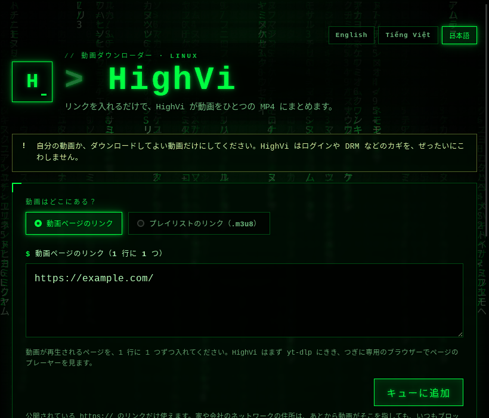
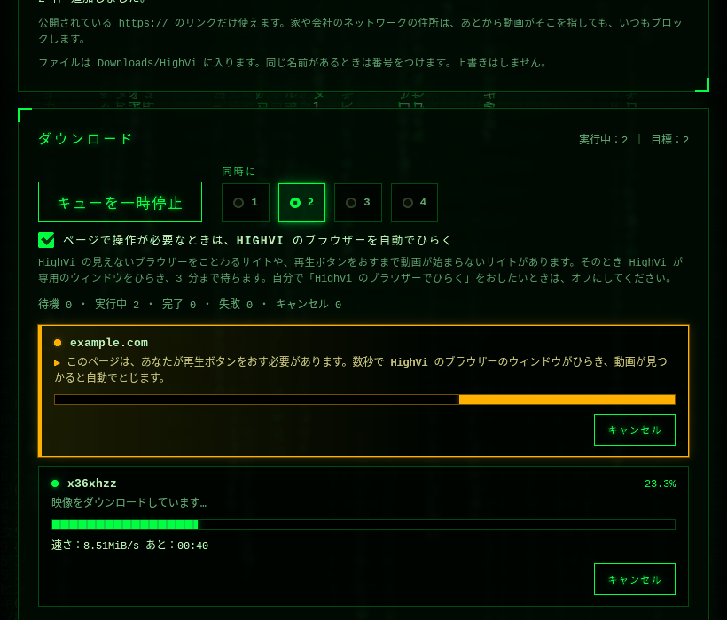
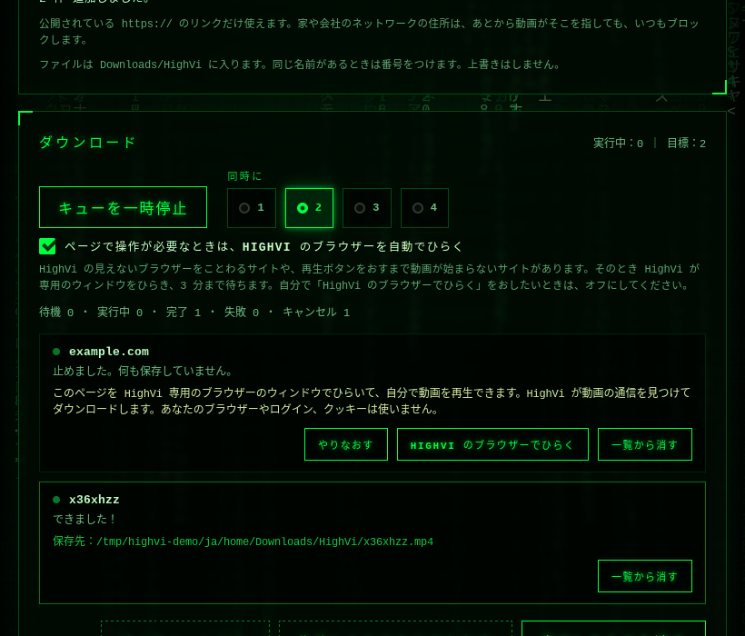
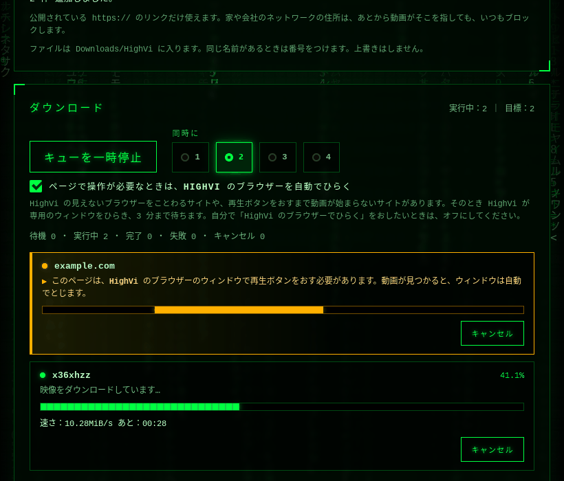
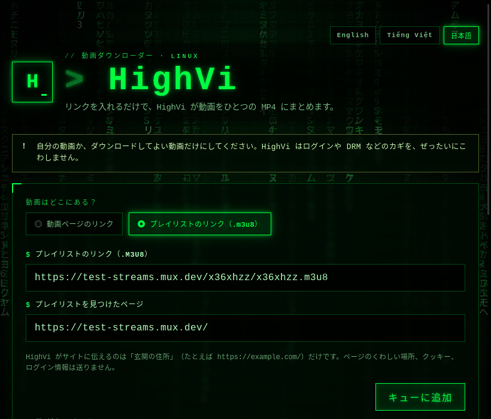

<div align="center">
  

  <p>
    <a href="README.md">English</a> ·
    <a href="README.vi.md">Tiếng Việt</a> ·
    <strong>日本語</strong>
  </p>

  <p>
    <a href="https://tauri.app/"></a>
    <a href="https://www.rust-lang.org/"></a>
    
    <a href="LICENSE"></a>
  </p>

  <p><code>&gt; 目をさませ…… 動画が待っている_</code></p>
</div>

<div align="center">

<a href="https://github.com/XKeviNguyen/HighVi/releases/download/v0.1.1/HighVi_0.1.1_amd64.deb"></a>

<sub>Ubuntu 24.04 / 26.04、64 ビット · <a href="https://github.com/XKeviNguyen/HighVi/releases/tag/v0.1.1">このリリースのすべてのファイル</a>（AppImage もあります）</sub>

</div>

```bash
sudo apt install ./HighVi_0.1.1_amd64.deb    # ダウンロードしたフォルダーで
```

## 🟩 HighVi って なに？

インターネットの動画の多くは、ひとつの大きなファイルではありません。**小さなかけら**にたくさん分かれていて、どのかけらがどこにあるかは **プレイリスト**（`.m3u8` で終わるファイル）という小さなリストに書いてあります。いわば **宝の地図** です。

HighVi はその地図を読んで、かけらをぜんぶ集め、**ひとつの MP4 ファイル** にくっつけます。どこでも見られる動画になります。

<div align="center">
  
  <br />
  <sub>HighVi の画面（Ubuntu で実際に動かした画面）</sub>
</div>

## 🕹️ 2つの使い方

| モード | 入れるもの | こんなときに |
| --- | --- | --- |
| **動画ページのリンク** | 動画があるページのリンク | ほとんどのページ：`yt-dlp` が知っているサイトも、JavaScript でプレーヤーを作るページも |
| **プレイリストのリンク（.m3u8）** | プレイリストのリンク **と**、それを見つけたページ | `.m3u8` のリンクをもう持っているとき |

HighVi は **English・Tiếng Việt・日本語** が使えます。右上のボタンでえらぶと、次からもその言葉で開きます。

**どうして「プレイリストのリンク」でもページを聞くの？**
「どこから来たの？」と言わないと地図をくれないサイトがあります。入口でチケットを見せるようなものです。このメモを **Referer（リファラー）** といいます。HighVi が伝えるのは、サイトの「玄関の住所」（たとえば `https://example.com/`）だけです。ページのくわしいリンクや、クッキー、ログイン情報は送りません。

**たくさんの動画をまとめて？** リンクを 1 行に 1 つずつ（1 回に 100 個まで）入れて、**キューを開始** をおします。HighVi は同時に **4 本** まで進めます。何本にするかは 1〜4 からえらべます。それぞれの行に、いま何をしているかが出ます（専用ブラウザーは 1 ページずつなので、その順番待ちも出ます）。どの行も、キャンセル・やりなおし・削除ができます。もうキューにあるリンクは、二重には入りません。

**DevTools や F12 は必要？** いりません。ページのリンクを入れるだけです。`yt-dlp` がサイトを知らないときは、HighVi が使い捨ての専用 Chrome（あなたのプロフィールやクッキーは使わず、通信はぜんぶ見はり番を通ります）でページを開き、ページ自身のプレーヤーに読みこませて、広告ではなく本編の動画をえらびます。**プレイリストのリンク** は、`.m3u8` をもう持っているとき用の上級者向けの方法です。

**サイトに ことわられた？** サイトによっては（Cloudflare のうしろにあることが多いです）、見えないところで動く自動のブラウザーをことわり、ふつうのブラウザーには同じページを見せます。そのときは、HighVi 専用のウィンドウが自動でひらくので、自分で動画を再生してください（下を見てください）。

## 🎬 チュートリアル

### 1. はじめてのダウンロード

1. HighVi をひらきます。**動画ページのリンク** はえらんだままにします。
2. 動画が再生されるページのアドレス（ブラウザーのアドレスバー）をコピーして、入力欄にはりつけます。
3. **キューに追加** をおします。欄の下に、いくつ追加したかが出ます。

<p align="center"><br /><sub>動画ページのリンク。追加するまえの状態です。</sub></p>
4. 下の **ダウンロード** までスクロールして、**キューを開始** をおします。行に、いまの手順が出ます：動画をさがしている、ダウンロード中、組み立て中、保存中。

<p align="center"><br /><sub>2 つの行：example.com はあなたの操作が必要なので、行がこはく色になり、数秒で HighVi のブラウザーがひらくと出ます（2 を見てください）。公開テスト用のストリームは、かけらを 4 つずつ、速さと残り時間を出しながらダウンロード中です。</sub></p>
5. 行に **保存先：…** と出たら、**フォルダーを開く** をおします。動画は `~/Downloads/HighVi` に、動画の名前で入っています。

<p align="center"><br /><sub>完了：MP4 の保存先が行に出ます。</sub></p>

たくさんの動画なら、手順 2 でリンクを 1 行に 1 つずつ入れて、**同時に** で 1〜4 本をえらびます。

### 2. サイトにことわられたとき

HighVi の見えないブラウザーをことわるサイトがあります（たとえば Cloudflare の見はり番、`host_firewall_block`）。

1. 行がこはく色になって 3 秒間点滅し、そのあと HighVi 専用のウィンドウで、ページが自動でひらきます。ウィンドウがあなたを待っているあいだ、行はこはく色のまま、やさしく光ります。（ウィンドウがとじられたか時間ぎれのときは、その行で **HighVi のブラウザーでひらく** をおします。）

<p align="center"><br /><sub>ウィンドウがひらいているあいだ、行にやることが出ます：そこで再生ボタンをおしてください。動画が見つかると、ウィンドウは自動でとじます。</sub></p>

<p align="center"><br /><sub>HighVi のブラウザー：タブが 1 つだけの、べつの専用 Chrome ウィンドウです。あなたのブラウザー、ログイン、クッキーは使いません。</sub></p>
2. 人間かどうかの確認を求められたら、そのウィンドウで自分で答えます。
3. いつものブラウザーと同じように、動画を再生します。
4. HighVi が動画のストリームを見つけてウィンドウをとじ、その行でダウンロードが続きます。

やめたいときは、ウィンドウをとじるか **キャンセル** をおします。このウィンドウもことわられるなら、HighVi ではそのサイトからダウンロードできません。

### 3. プレイリストのリンク（上級者向け）

動画の `.m3u8` のリンクをもう持っているときだけ使います：

1. **プレイリストのリンク（.m3u8）** をえらびます。
2. `.m3u8` のリンクを **プレイリストのリンク（.m3u8）** に、それを見つけたページのアドレスを **プレイリストを見つけたページ** に入れます。

<p align="center"><br /><sub>公開テスト用のストリームとそのページを入れた、プレイリストのリンクのモード。</sub></p>
3. **キューに追加**、それから **キューを開始** をおします。

うまくいかないときは、下の「うまくいかないときは」を見てください。失敗した行の **診断情報をコピー** で、バグ報告用の短いレポート（リンク、クッキー、パスワードはふくみません）をコピーできます。

## ✅ HighVi がすること

1. リンクを入れて **MP4 をダウンロード** をおします。
2. HighVi が `https://` のリンクかを調べてから、専用の **ネットワークの見はり番** を動かします。`yt-dlp` の通信（ページ、リダイレクト、プレイリスト、かけら、カギ）は、ぜんぶ公開されたインターネットの住所にしか行けません。家や会社のネットワークの中のパソコンには、いつもつながりません。
3. `yt-dlp` が宝の地図をさがします。見つからなければ、HighVi が専用のブラウザーでページのプレーヤーが読みこむプレイリストを見ます。そのあと、いちばんきれいな映像（音声が別なら音声も）をえらびます。
4. かけらを 4 つずつダウンロードして、あなたのパソコンの中でひとつの MP4 にまとめます。進みぐあい、速さ、のこり時間が見えて、いつでも **キャンセル** できます。
5. できた動画は **`~/Downloads/HighVi`** に、動画のタイトルの名前で入ります。同じ名前があれば ` (2)` をつけます。上書きはしません。**フォルダーを開く** で見られます。

## 🧭 キューの使いかた

1. 動画ページのリンクを 1 行に 1 つずつ（1 回に 100 個まで）入れて、**キューに追加** をおします。重なったリンクや正しくない行は一覧に出て、追加されません。
2. **キューを開始** をおします。**同時に** で 1〜4 本をいっしょに進められます（はじめは 2 本）。数をへらしても、いまダウンロード中のものは止まりません。多い分が先に終わります。
3. それぞれの行に、いまの手順が出ます：動画をさがしている、*専用ブラウザーの順番を待っている*（ブラウザーがいるページは 1 つずつです）、*数秒で HighVi のブラウザーがひらく*（行がこはく色になります。下を見てください）、ダウンロード中、*組み立ての順番を待っている*、保存中。
4. **ページで操作が必要なときは、HighVi のブラウザーを自動でひらく** は、はじめからオンです。自分で **HighVi のブラウザーでひらく** をおしたいときはオフにしてください。この設定はこのパソコンに保存され、ダウンロード中のものにもすぐに効きます。
5. 行ごとに **キャンセル**、**やりなおし**、**削除**、そしてウィンドウで助かりそうなページには **HighVi のブラウザーでひらく** があります。キュー全体には **キューを一時停止**、**すべてキャンセル**、**失敗したものをやりなおす**、**完了したものを消す** があります。
6. 失敗した行では、診断情報（手順、エラーコード、ツールのバージョン、ホスト名。リンク、クッキー、パスワードはふくみません）を見て、バグ報告にコピーできます。

キューはメモリの中だけにあります。HighVi を閉じると、ダウンロード中のものは止まり（終わったファイルは残ります）、一覧は消えます。

## 🌐 HighVi のブラウザーでひらく

ページが HighVi の見えないブラウザーをことわったときや、プレーヤーで再生ボタンをおす必要があるときは、HighVi がそのページを HighVi の見えるウィンドウで自動でひらきます。いきなりひらくことはありません：その前に行が **こはく色になって 3 秒間点滅** し、「このページは、あなたが再生ボタンをおす必要があります。数秒で HighVi のブラウザーのウィンドウがひらき、動画が見つかると自動でとじます。」と出ます。その数秒のうちに **キャンセル** をおすか、**HighVi のブラウザーを自動でひらく** をオフにすれば、ウィンドウはひらきません。ウィンドウがとじられたか時間ぎれのときは、**HighVi のブラウザーでひらく** でもう一度ひらけます：

1. ウィンドウは、このページのためだけに作った、まっさらな Chrome のプロフィールです。あなたのブラウザーではありません。履歴、ログイン、クッキー、拡張機能はなく、終わったら消されます。
2. いつものようにページを使って、動画を再生してください。HighVi がウィンドウの通信を見て、動画の流れ（ストリーム）をさがします。DevTools もリンクのコピーもいりません。
3. ストリームが HighVi のチェックを通ると、すぐにウィンドウがとじて、いつものようにキューでダウンロードが続きます。チェックを通らない広告や予告編では、ウィンドウはとじません。

- ウィンドウの Web の通信は、これまでどおり HighVi の見はり番を通ります（公開されている `https://` だけ）。Chrome のサンドボックスもオンのままです。ほかのアプリにわたすリンク（`mailto:`、`magnet:` など）はどこにも行かず、ファイルのアップロードもできません。
- HighVi がウィンドウの中で、かわりに再生ボタンをおしたり、クリックしたりすることはありません。
- HighVi が自分でひらいたウィンドウは 3 分まで、ボタンでひらいたウィンドウは 10 分まで待ちます。HighVi のブラウザーは一度に 1 つだけです。ほかのページが使っているときは、あいたときにウィンドウがひらきます。ブラウザーがいらないダウンロードは進みつづけます。
- ウィンドウをとじると、その回は終わりです（`browser_closed`）。**キャンセル** も使えます。
- ふつうのデスクトップのウィンドウなので、ほかのアプリと同じようにクリップボードを使います。X11（Wayland ではない）では、同じ画面のアプリどうしがおたがいのウィンドウを見られます。

> [!NOTE]
> 見えるブラウザーでも、サイトにことわられたり、人間かどうかの確認を求められたりすることがあります。HighVi がその確認にかわりに答えることはありません。サイトが通してくれたのは、あなたが許されているからで、HighVi が何かをすりぬけたからではありません。

## 🛑 HighVi が ぜったいに しないこと

- DRM や有料の壁、ログインをこわすこと。
- ブラウザのクッキーやログイン状態を使うこと。
- ブラウザのふりをして、ボット対策をすりぬけること。
- あなたの `yt-dlp` 設定にあるプラグインや、よけいなコマンドを動かすこと。
- ボットの確認や CAPTCHA をかわりにとくこと。あなたのブラウザーからクッキーをうつすこと。

## 🔒 プライバシーと安全

- **パソコンの外に出るのは、ダウンロードの通信だけです。** HighVi にはアカウントも、利用データの送信も、アップデートの確認もありません。
- **リンクは HighVi の中だけにあります。** 署名つきの動画リンクが、HighVi の画面やログ、ほかのプログラムのコマンドラインに出ることはありません。保存した動画には、元のリンクやタグは入りません。
- **通信はすべて 1 つの見はり番を通ります。** `yt-dlp` とブラウザーは、HighVi の見はり番を通して、公開されている `https://` のアドレスにだけつながります。家や会社のネットワークにはとどきません。
- **使いすての作業場所。** ダウンロードごとに専用のフォルダー（`~/Downloads/HighVi/.highvi-job-…`、権限 `0700`）を使い、終わったら消します。アプリが落ちたあとは、次に HighVi を開いたときに消します。HighVi が強制終了されると、そのツールもいっしょに止まります。
- **ディスクで おどろかせません。** HighVi はファイルを上書きしません。同じ名前があると ` (2)` をつけます。
- **診断情報は あなたのものです。** 見たいときにだけ表示され、どこにも送られません。

> [!IMPORTANT]
> 自分の動画か、ダウンロードしてよいと許可された動画だけをダウンロードしてください。

## 🚀 はじめかた

**Ubuntu**、**Rust**、**Node.js**、**`yt-dlp`**、**FFmpeg** が必要です。**Google Chrome か Chromium** はなくても動きますが、ないと JavaScript でプレーヤーを作るページはさがせません。

Tauri に必要なライブラリを入れます：

```bash
sudo apt update
sudo apt install build-essential curl wget file libxdo-dev libssl-dev \
  libayatana-appindicator3-dev librsvg2-dev libwebkit2gtk-4.1-dev ffmpeg
```

`yt-dlp` は **2025.11.12 以降** を入れて、いつも新しくしておきましょう（HighVi は 2026.03.17 と 2026.08.19 でテストしています）。Ubuntu 26.04 のパッケージなら大丈夫ですが、**Ubuntu 24.04 のものは古すぎます**（2024.04.09）。24.04 では pipx で入れて、新しいほうが先に見つかるように **いったんログアウトしてログインしなおして** ください：

```bash
sudo apt install pipx && pipx install yt-dlp
```

そのあと、ちゃんと入ったか確かめます：

```bash
yt-dlp --version && ffmpeg -version && node --version && cargo --version
```

アプリを動かします：

```bash
npm install
npm run dev     # HighVi を開く
npm run build   # .deb と AppImage を作る
```

## 📦 インストール・アップグレード・アンインストール

[v0.1.1 のリリース](https://github.com/XKeviNguyen/HighVi/releases/tag/v0.1.1) から `.deb`（または AppImage）をダウンロードするか、自分でパッケージを作ってください（**はじめかた** を見てください）。

**`.deb` を入れる**（Ubuntu/Debian。`yt-dlp` と FFmpeg もいっしょに入ります）：

```bash
sudo apt install ./HighVi_0.1.1_amd64.deb
```

Ubuntu 24.04 では、新しい `yt-dlp` も pipx で入れてください（**はじめかた** を見てください）。JavaScript でプレーヤーを作るページと **HighVi のブラウザーでひらく** のために、Google Chrome か Chromium を入れてください。Ubuntu の snap 版 Chromium でも動きます。

**アップグレード**：新しい `.deb` を同じように入れます。バージョン番号が変わっていないときは `--reinstall` をつけてください。つけないと apt は古いほうをのこします：

```bash
sudo apt install --reinstall ./HighVi_0.1.1_amd64.deb
```

**アンインストール**：`sudo apt remove high-vi`。`~/Downloads/HighVi` の動画は残ります。

**AppImage**（`yt-dlp` と FFmpeg が `PATH` にあること）：

```bash
chmod +x HighVi_0.1.1_amd64.AppImage
./HighVi_0.1.1_amd64.AppImage
```

FUSE のエラーが出るときは `APPIMAGE_EXTRACT_AND_RUN=1` をつけて動かしてください。

動画は **`~/Downloads/HighVi`**（または、あなたの言語のダウンロードフォルダーの `HighVi`）に保存されます。

## 🧯 うまくいかないときは

| エラーコード | どういうこと？ | ためしてみよう |
| --- | --- | --- |
| `access_denied` / `host_firewall_block` | サイトに **ことわられました**（HTTP 403）。 | `.m3u8` をページの欄に入れたなら、**プレイリストのリンク** に切りかえて、見つけたページも入れましょう。ページが合っているか見直すか、新しいプレイリストをコピーしてください。ブラウザでのログインが必要なサイトには、HighVi は使えません。 |
| `unsupported_page` | `yt-dlp` がこのサイトを知らず、さらにさがすためのブラウザーも入っていません。 | Google Chrome か Chromium を入れるか、**プレイリストのリンク** を使いましょう。 |
| `no_media_found` | 専用のブラウザーでページを開きましたが、動画は読みこまれませんでした。 | ログインや特別なボタンが必要なのかも。HighVi はそれをすりぬけません。 |
| `browser_failed` | 専用のブラウザーがとちゅうで止まりました。 | もう一度ためしましょう。 |
| `unsupported_playlist` | HighVi が読めるプレイリストではありません。 | `.m3u8` のリンクそのものか確かめましょう。 |
| `media_not_found` | 動画がなくなっています（HTTP 404/410）。 | リンクの期限が切れたのかも。新しいリンクをコピーしましょう。 |
| `drm_not_supported` | 動画に DRM のカギがかかっています。 | HighVi はカギを開けません。 |
| `authentication_required` | ログインしないと見られません。 | HighVi はあなたのログインを使いません。 |
| `network_timeout` | サイトの返事がおそすぎました。 | しばらくしてから、もう一度ためしましょう。 |
| `unsafe_network_target` | 動画が家や会社のネットワークの中のパソコンにつなごうとしました。 | HighVi がわざとブロックしています。 |
| `live_not_supported` | ライブ配信です。 | HighVi は配信が終わった動画だけダウンロードします。 |
| `missing_dependency` | `yt-dlp` か FFmpeg が入っていません。 | 入れてから、もう一度ためしましょう。 |
| `ytdlp_too_old` | `yt-dlp` が 2025.11.12 より古く、HighVi の安全のための設定が使えません。 | pipx で新しいものを入れて（「はじめかた」を参照）、ログアウトしてログインしなおしましょう。 |
| `rate_limited` | サイトに「たのみすぎ」と言われました（HTTP 429）。 | しばらく待って、同時に進める本数をへらしましょう。 |
| `media_access_denied` | ページは見つかりましたが、動画のサーバーに **ことわられました**（HTTP 403）。 | `yt-dlp` が古いことが多いので、新しくしましょう。自分のプレーヤーにしか出さないサイトもあります。 |
| `download_stalled` | ダウンロードが 2 分のあいだ止まりました。 | あとでもう一度ためしましょう。 |
| `download_timeout` | ひとつの部分に 24 時間以上かかりました。 | 速い回線でためしましょう。 |
| `insufficient_disk_space` | 動画を入れる空きがたりません。 | 空きをつくってから、やりなおしましょう。 |
| `discovery_overloaded` | ページの通信が多すぎて、専用ブラウザーで追いきれませんでした。 | `.m3u8` があれば **プレイリストのリンク** を使いましょう。 |
| `browser_closed` | 動画が始まる前に、HighVi のブラウザーのウィンドウがとじられました。 | もう一度ひらいて、そこで動画を再生しましょう。そのままにしてもかまいません。 |
| `interactive_timeout` | 時間内に（3 分、ボタンでひらいたときは 10 分）、HighVi のブラウザーで動画が始まりませんでした。 | もう一度ひらいて、ウィンドウで動画を再生しましょう。 |
| `browser_no_display` | ブラウザーのウィンドウをひらく画面（ディスプレイ）が見つかりませんでした。 | いつものデスクトップから HighVi を動かしましょう。 |
| `queue_full` / `batch_too_large` | キューに入るのは 200 本まで、1 回に入れられるのは 100 個までです。 | 終わった行を消すか、入れるリンクをへらしましょう。 |

## ❓ よくある質問

**自分の Chrome では再生できるのに、HighVi だと失敗するのはなぜ？** たいていは、サイトが見えないところで動く自動のブラウザーをことわっています（`host_firewall_block` か `access_denied` が出ます）。そのとき HighVi が自分のウィンドウをひらくので、再生ボタンをおしてください（**HighVi のブラウザーでひらく** をおしてもかまいません）。そのウィンドウもことわられるなら、HighVi ではそのサイトからダウンロードできません。

**HighVi のブラウザーは、わたしの Chrome のプロフィールやパスワード、クッキーを使う？** 使いません。べつの、からっぽのプロフィールで、終わったら消します。HighVi があなたのブラウザーのデータを読むことはありません。

**YouTube で 403 になります。** `yt-dlp` が YouTube には古すぎます（2026.08.19 以降が必要です）。**はじめかた** のように新しくしてください。

**Wayland や HiDPI の画面でも動く？** 動きます。HighVi もそのブラウザーのウィンドウも、Wayland と X11 でそのまま動き、画面に合わせて大きさが変わります。

**いくつまで同時にダウンロードできる？** 4 本までです。1〜4 から えらべます。ブラウザーがいるページは 1 つずつ使います。

**ダウンロードがおそい？** HighVi は 1 本の動画のかけらを 4 つ同時にダウンロードします。`yt-dlp` の初期設定（1 つずつ）より、たいてい何倍も速いです。同時に進む動画は回線を分けあうので、1 本を最高の速さで進めたいときは **同時に** を 1 にしてください。わざと 1 つの接続ごとの速さをおさえるサイトもあります。

**DRM のかかった動画やライブ配信は？** ダウンロードできませんし、ためすこともしません。

## 🚧 いまの制限

- **HLS とふつうの MP4 だけ。** DASH だけのサイト、ライブ配信、DRM つきの動画は、わざとことわります。
- **ログインもクッキーも使いません。** ログインが必要な動画や、ページがプレーヤー用にセットするクッキーが必要な動画はダウンロードできません。HighVi はあなたのブラウザーのログインを借りません。
- **ブラウザーでさがすことと HighVi のブラウザーでひらくことには、Google Chrome か Chromium が必要です。** HighVi はブラウザーを同梱していません。Ubuntu の snap 版 Chromium でも動きます（snap の Chromium 155 で、ブラウザーのテストはすべて通りました）。
- **見える HighVi のブラウザーでも、サイトにことわられることがあります**（ボットの確認、ログイン、地域の制限）。HighVi はそれを伝えるだけで、すりぬけはしません。
- **特別なボタンが必要なプレーヤー**（独自の再生ボタン、年齢確認、同意画面）はおしません。HighVi が動かすのはふつうの `<video>` だけです。
- **システムや会社のプロキシは使いません。** HighVi の見はり番だけが外への出口です。直接つなげないネットワークではダウンロードできません。
- **`http://` の動画はことわります。** ページが `https://` でも同じです。
- **Linux だけ。** Ubuntu 26.04、Google Chrome 153/154、yt-dlp 2026.03.17 と 2026.08.19、FFmpeg 8 でテストしています。Ubuntu 24.04 では `.deb` を入れて起動できることだけ、Wayland では起動と HiDPI でくっきり表示されることだけをたしかめました。
- **同時に 4 本まで。** 専用ブラウザーは 1 ページずつです。HighVi を閉じるとキューは消えます。
- **ブラウザーで見つけた、とても長い（8 KiB をこえる）動画の URL は無視します。**

## 🧠 開発する人へ

しくみ・図・流れ・上限は [docs/ARCHITECTURE.md](docs/ARCHITECTURE.md)、開発の流れ・CI・レビュー・リリースは [docs/WORKFLOW.md](docs/WORKFLOW.md)、出会ったバグと直し方・学んだことは [docs/JOURNEY.md](docs/JOURNEY.md) にあります。

```bash
HIGHVI_REQUIRE_E2E=1 cargo test --workspace --offline
cargo clippy --workspace --all-targets --offline -- -D warnings
cargo fmt --all -- --check
node --check ui/app.js && node --check ui/i18n.js && node --check ui/rain.js
node scripts/check-ui.mjs   # translation parity
```

```text
crates/highvi-core/   ネットワークの見はり番（egress proxy）、動画さがし、形式えらび、ダウンロード、MP4 づくり、安全な保存
                      （ユニットテスト＋本物の yt-dlp/FFmpeg とローカル HTTPS サーバーでの end-to-end テスト）
src-tauri/            Tauri のコマンド：ダウンロードのキュー、進みぐあい、フォルダーを開く
ui/                   みどりの画面：index.html、styles.css、app.js、i18n.js（English・Tiếng Việt・日本語）、rain.js
docs/assets/          README のバナーとスクリーンショット
```

HighVi の安全のしくみと、いまの限界は [SECURITY.md](SECURITY.md) に書いてあります。かんたんに言うと、HighVi の道具の通信はぜんぶ、公開された HTTPS の住所だけを通す見はり番を通ります。FFmpeg はネットワークを使いません。

## ⚖️ 免責事項

**あなたの責任。** HighVi は道具です。何をダウンロードするかを決めるのはあなたで、その権利があるかを確かめる責任もあなたにあります。著作権、サイトの利用規約、動画に映っている人の権利は、すべてあなたに関わります。向いている使い方は、自分で作った動画、クリエイティブ・コモンズやパブリックドメインの作品、ライセンスや規約でダウンロードが許されている作品、そして住んでいる国の法律が認める範囲での個人用コピーです。EU では、もとが違法なものからの私的コピーは、ふつう合法になりません。海賊版や流出した作品、本人の同意がない性的な画像やプライベートな画像を、ダウンロードしたり、持っていたり、共有したりしないでください。アメリカや EU など多くの国で、そうした画像の共有は犯罪です。

**HighVi がしないこと。** HighVi は DRM で保護された動画をことわるように作られていて、DRM を外そうとはしません。あなたのブラウザーのクッキーやログイン状態は使いません。有料の壁、ログイン、CAPTCHA、ボットチェックを通りぬけようともしません。サイトが見えないブラウザーをことわったときは、HighVi が見えるウィンドウをひらき、どうするかはあなたが決めます。HighVi はあなたのコンピューターの中だけで動きます。サーバーもアカウントも利用データの送信もなく、ダウンロードしたものが開発者に送られることもありません。開発者は、どのサイトや作品も置いておらず、まとめてもおらず、リンクもしておらず、おすすめもしていません。

**保証なし・責任の制限。** HighVi は [MIT ライセンス](LICENSE)の無料ソフトウェアで、「現状のまま」（as is）提供され、どんな保証もありません。法律が許す範囲で、作者は使用から生じるどんな請求、損害、その他の責任も負いません。法律がこの制限を認めない場合は、認められる範囲でだけ適用されます。

**法的助言ではありません。** このプロジェクトのどの内容も法的助言ではありません。法律は国によってちがい、変わることもあります。ダウンロードしてよいか迷ったら、やめるか、弁護士に相談してください。

**削除の依頼・連絡先。** このプロジェクトのコード、ドキュメント、例が、あなたが権利を持つ作品や、あなたが映っている作品を指していると思ったら、[issue をひらいて](https://github.com/XKeviNguyen/HighVi/issues)ください。セキュリティの報告は [SECURITY.md](SECURITY.md) を見てください。報告には誠実に対応します。HighVi は各ユーザーのコンピューターの外に何も保存しないので、プロジェクトがそこから消せるものはありません。

## 📜 ライセンス

[MIT](LICENSE)

<div align="center"><sub><code>スプーンなんて ない —— あるのは かけらだけ_</code></sub></div>
