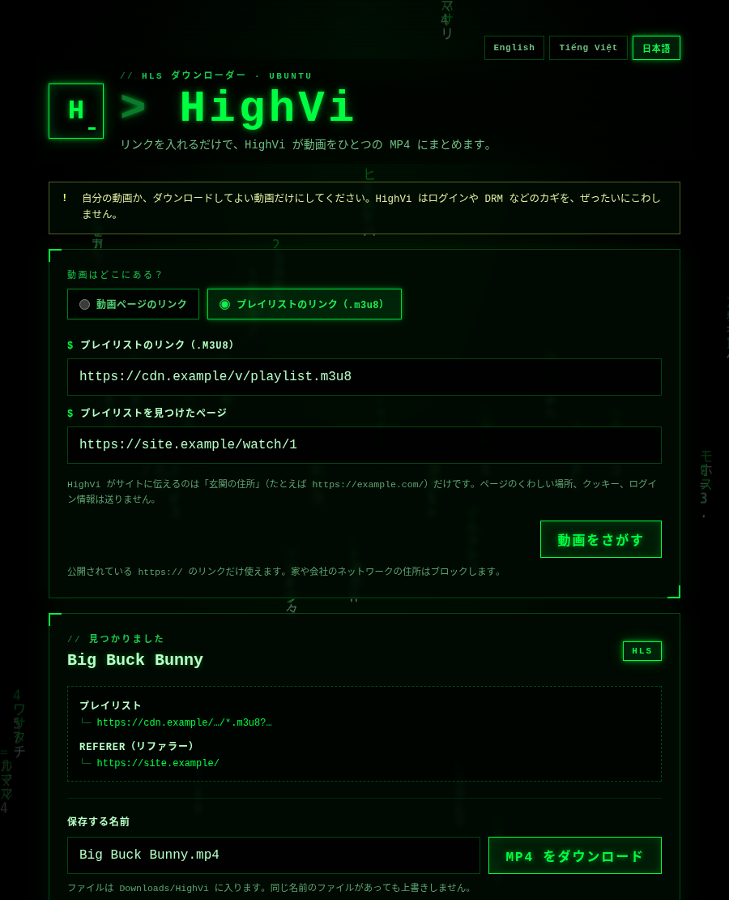

<div align="center">
  

  <p>
    <a href="README.md">English</a> ·
    <a href="README.vi.md">Tiếng Việt</a> ·
    <strong>日本語</strong>
  </p>

  <p>
    <a href="https://tauri.app/"></a>
    <a href="https://www.rust-lang.org/"></a>
    
    <a href="LICENSE"></a>
  </p>

  <p><code>&gt; 目をさませ…… 動画が待っている_</code></p>
</div>

## 🟩 HighVi って なに？

インターネットの動画の多くは、ひとつの大きなファイルではありません。**小さなかけら**にたくさん分かれていて、どのかけらがどこにあるかは **プレイリスト**（`.m3u8` で終わるファイル）という小さなリストに書いてあります。いわば **宝の地図** です。

HighVi はその地図を読んで、かけらをぜんぶ集め、**ひとつの MP4 ファイル** にくっつけます。どこでも見られる動画になります。

<div align="center">
  
  <br />
  <sub>HighVi の画面（表示しているのは例のデータです）</sub>
</div>

## 🕹️ 2つの使い方

| モード | 入れるもの | こんなときに |
| --- | --- | --- |
| **動画ページのリンク** | 動画があるページのリンク | `yt-dlp` が知っているサイト |
| **プレイリストのリンク（.m3u8）** | プレイリストのリンク **と**、それを見つけたページ | `.m3u8` のリンクをもう持っているとき |

HighVi は **English・Tiếng Việt・日本語** が使えます。右上のボタンでえらぶと、次からもその言葉で開きます。

**どうして「プレイリストのリンク」でもページを聞くの？**
「どこから来たの？」と言わないと地図をくれないサイトがあります。入口でチケットを見せるようなものです。このメモを **Referer（リファラー）** といいます。HighVi が伝えるのは、サイトの「玄関の住所」（たとえば `https://example.com/`）だけです。ページのくわしいリンクや、クッキー、ログイン情報は送りません。

**プレイリストのリンクはどこにあるの？** ブラウザで <kbd>F12</kbd> をおして **Network（ネットワーク）** タブを開き、動画を再生して、フィルターに `m3u8` と入れてみましょう。ダウンロードしてよい動画だけにしてくださいね。

## ✅ HighVi がすること

1. リンクを入れます。
2. HighVi が、安全な `https://` のリンクか、家や会社のネットワークの中のパソコンではないかを調べます。
3. `yt-dlp` が宝の地図をさがします。
4. HighVi が動画のタイトル、**短くした** プレイリストのリンク（ひみつの部分はかくします）、送る Referer を見せます。
5. 名前を決めて **MP4 をダウンロード** をおします。
6. できた動画は **`~/Downloads/HighVi`** に入ります。同じ名前のファイルがあっても、上書きはしません。

## 🛑 HighVi が ぜったいに しないこと

- DRM や有料の壁、ログインをこわすこと。
- ブラウザのクッキーやログイン状態を使うこと。
- ブラウザのふりをして、ボット対策をすりぬけること。
- あなたの `yt-dlp` 設定にあるプラグインや、よけいなコマンドを動かすこと。

> [!IMPORTANT]
> 自分の動画か、ダウンロードしてよいと許可された動画だけをダウンロードしてください。

## 🚀 はじめかた

**Ubuntu**、**Rust**、**Node.js**、**`yt-dlp`**、**FFmpeg** が必要です。

Tauri に必要なライブラリを入れます：

```bash
sudo apt update
sudo apt install build-essential curl wget file libxdo-dev libssl-dev \
  libayatana-appindicator3-dev librsvg2-dev libwebkit2gtk-4.1-dev ffmpeg
```

`yt-dlp` はパッケージマネージャーか [公式プロジェクト](https://github.com/yt-dlp/yt-dlp) から入れて、いつも新しくしておきましょう。そのあと、ちゃんと入ったか確かめます：

```bash
yt-dlp --version && ffmpeg -version && node --version && cargo --version
```

アプリを動かします：

```bash
npm install
npm run dev     # HighVi を開く
npm run build   # .deb と AppImage を作る
```

## 🧯 うまくいかないときは

| エラーコード | どういうこと？ | ためしてみよう |
| --- | --- | --- |
| `access_denied` / `host_firewall_block` | サイトに **ことわられました**（HTTP 403）。 | `.m3u8` をページの欄に入れたなら、**プレイリストのリンク** に切りかえて、見つけたページも入れましょう。ページが合っているか見直すか、新しいプレイリストをコピーしてください。ブラウザでのログインが必要なサイトには、HighVi は使えません。 |
| `unsupported_page` | `yt-dlp` がこのサイトを知らないか、プレーヤーが JavaScript で作られています。 | プレイリストのリンクがあれば **プレイリストのリンク** を使いましょう。 |
| `unsupported_playlist` | HighVi が読めるプレイリストではありません。 | `.m3u8` のリンクそのものか確かめましょう。 |
| `media_not_found` | 動画がなくなっています（HTTP 404/410）。 | リンクの期限が切れたのかも。新しいリンクをコピーしましょう。 |
| `drm_not_supported` | 動画に DRM のカギがかかっています。 | HighVi はカギを開けません。 |
| `authentication_required` | ログインしないと見られません。 | HighVi はあなたのログインを使いません。 |
| `network_timeout` | サイトの返事がおそすぎました。 | しばらくしてから、もう一度ためしましょう。 |
| `output_exists` | 同じ名前のファイルがもうあります。 | べつの名前にしましょう。 |
| `missing_dependency` | `yt-dlp` か FFmpeg が入っていません。 | 入れてから、もう一度ためしましょう。 |

## 🧠 開発する人へ

```bash
cargo test --workspace --offline
cargo clippy --workspace --all-targets --offline -- -D warnings
cargo fmt --all -- --check
node --check ui/app.js && node --check ui/i18n.js && node --check ui/rain.js
```

```text
crates/highvi-core/   URL のチェック、Referer のルール、yt-dlp の引数、エラーメッセージ（ぜんぶテストつき）
src-tauri/            Tauri のコマンド：yt-dlp を動かす、進みぐあいを知らせる、ファイルを安全に保存する
ui/                   みどりの画面：index.html、styles.css、app.js、i18n.js（English・Tiếng Việt・日本語）、rain.js
docs/assets/          README のバナーとスクリーンショット
```

HighVi の安全のしくみと、いまの限界は [SECURITY.md](SECURITY.md) に書いてあります。かんたんに言うと、HighVi はあなたが入れたリンクはチェックしますが、動画のかけらは `yt-dlp` が自分でダウンロードするので、そのあとの通信をひとつずつチェックすることは、まだできていません。

## 📜 ライセンス

[MIT](LICENSE)

<div align="center"><sub><code>スプーンなんて ない —— あるのは かけらだけ_</code></sub></div>
