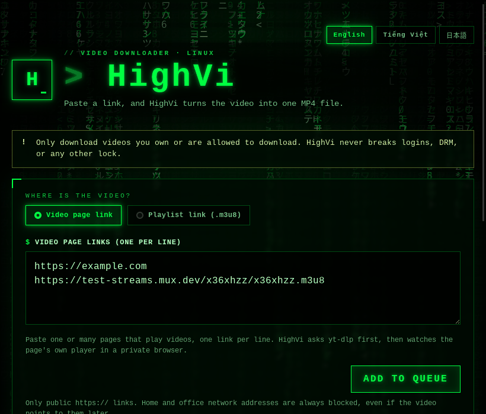
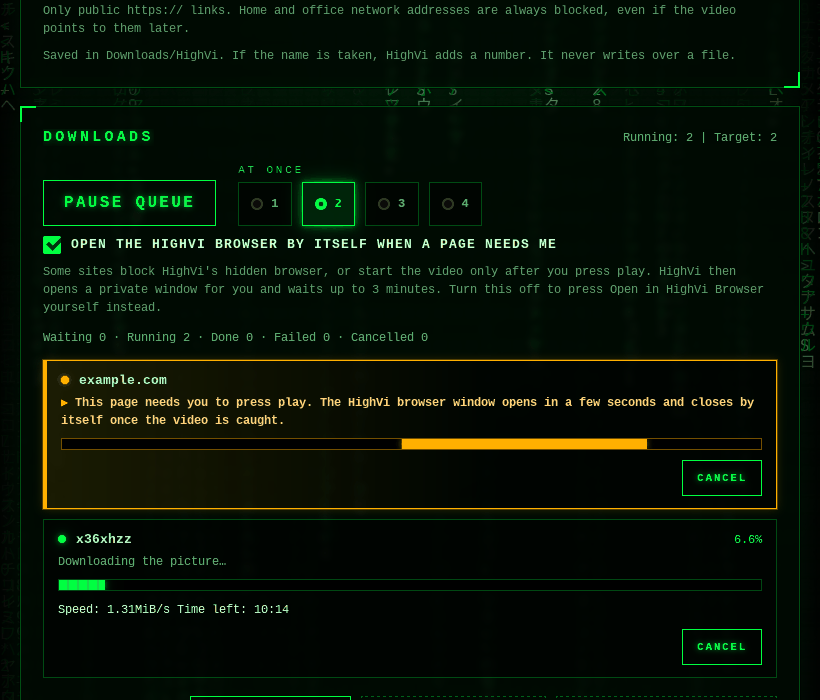
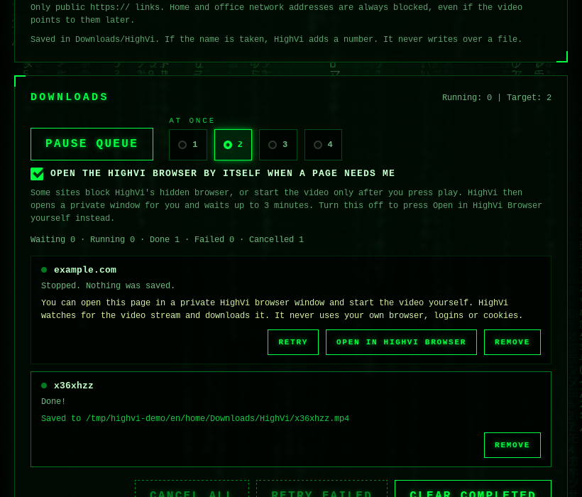
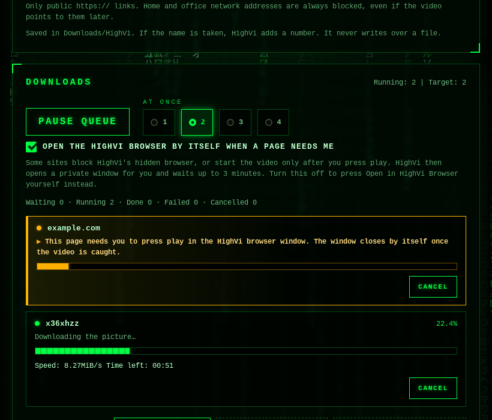
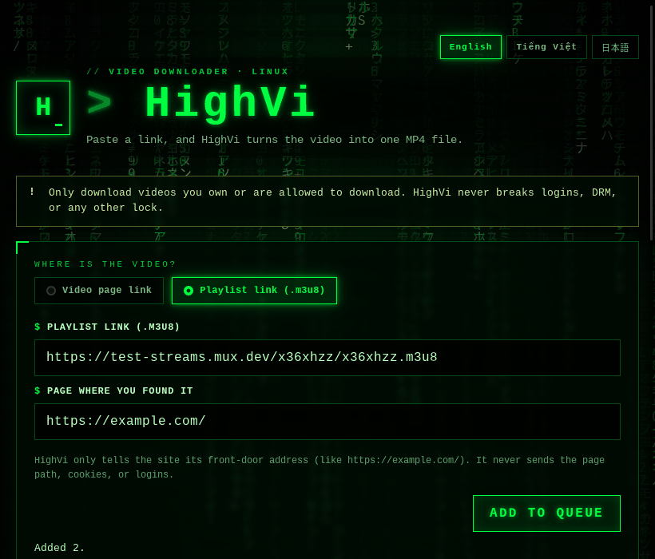

<div align="center">
  

  <p>
    <strong>English</strong> ·
    <a href="README.vi.md">Tiếng Việt</a> ·
    <a href="README.ja.md">日本語</a>
  </p>

  <p>
    <a href="https://tauri.app/"></a>
    <a href="https://www.rust-lang.org/"></a>
    
    <a href="LICENSE"></a>
  </p>

  <p><code>&gt; wake up... the video is waiting_</code></p>
</div>

<div align="center">

<a href="https://github.com/XKeviNguyen/HighVi/releases/download/v0.1.0/HighVi_0.1.0_amd64.deb"></a>

<sub>Ubuntu 24.04 / 26.04, 64-bit · <a href="https://github.com/XKeviNguyen/HighVi/releases/tag/v0.1.0">all files of this release</a> (also an AppImage)</sub>

</div>

```bash
sudo apt install ./HighVi_0.1.0_amd64.deb    # in the folder you downloaded it to
```

## 🟩 What is HighVi?

Lots of videos on the internet aren't one big file. They're chopped into **lots of tiny pieces**, and a small list called a **playlist** (a file ending in `.m3u8`) says where every piece lives. Think of it as a **treasure map**.

HighVi reads the treasure map, collects every piece, and glues them back together into **one MP4 file** you can watch anywhere.

<div align="center">
  
  <br />
  <sub>The real HighVi window on Ubuntu.</sub>
</div>

## 🕹️ Two ways to use it

| Mode | You paste | Good for |
| --- | --- | --- |
| **Video page link** | The link to the video page | Almost everything: sites `yt-dlp` knows, and pages whose player is built with JavaScript |
| **Playlist link (.m3u8)** | The playlist link **and** the page you found it on | When you already have the `.m3u8` link |

HighVi speaks **English, Tiếng Việt, and 日本語**. Pick one with the buttons in the top corner, and HighVi will remember it.

**Why does “Playlist link” ask for the page too?**
Some websites only hand out the treasure map if you say where you came from, like showing a ticket at the door. That note is called the **Referer**. HighVi only tells them the website's front-door address (for example `https://example.com/`). It never sends the rest of the page link, your cookies, or your logins.

**Many videos at once?** Paste one link per line (up to 100 at a time) and press **Start queue**. HighVi works on up to **four** at once; you choose 1–4. Each row shows what it is doing, including when it is waiting for the private browser (one page at a time). You can cancel, retry, or remove any row. A link that is already in the queue isn't added twice.

**Do I need DevTools or F12?** No. Paste the page link. If `yt-dlp` doesn't know the site, HighVi opens the page in a private, throw-away Chrome (not your profile, no cookies, every request through the network guard), lets the page's own player load, and picks the main video, not the adverts. The **Playlist link** mode is only an advanced fallback for when you already have the `.m3u8` link.

**The site refuses HighVi?** Some sites, often behind Cloudflare, turn away hidden, automated browsers while showing the same page to a normal one. HighVi then opens a visible, private HighVi window by itself, where you start the video yourself (see below).

## 🎬 Tutorial

### 1. Your first download

1. Open HighVi. Keep **Video page link** selected.
2. Copy the address of the page where the video plays (from your browser's address bar) and paste it into the box.
3. Press **Add to queue**. Under the box, HighVi says how many links it added.

<p align="center"><br /><sub>A video page link, ready to add.</sub></p>
4. Scroll to **Downloads** and press **Start queue**. The row shows each step: looking for the video, downloading, putting it together, saving.

<p align="center"><br /><sub>Two rows: example.com needs you, so its row turns amber and says the HighVi browser opens in a few seconds (see section 2). The public test stream downloads four pieces at a time, with speed and time left.</sub></p>
5. When the row says **Saved to …**, press **Open folder**. Your video is in `~/Downloads/HighVi`, named after the video.

<p align="center"><br /><sub>Done: the row shows where the MP4 was saved.</sub></p>

Several videos? Paste one link per line in step 2, and pick how many run together under **At once** (1–4).

### 2. When a site refuses HighVi

Some sites turn away HighVi's hidden browser (for example Cloudflare's guard, `host_firewall_block`).

1. The row turns amber and pulses for 3 seconds, then a private HighVi window opens with the page by itself. The row stays amber and glows gently while the window waits for you. (If the window was closed or timed out, press **Open in HighVi Browser** on that row.)

<p align="center"><br /><sub>While the window is open, the row says what to do: press play there. The window closes by itself once the video is caught.</sub></p>

<p align="center"><br /><sub>The HighVi browser: a separate, private Chrome window with one tab. Your own browser, logins and cookies are never used.</sub></p>
2. If the site asks you to confirm you are human, do it yourself, in that window.
3. Start the video, as you would in any browser.
4. HighVi spots the video stream, closes the window, and the download carries on in the row.

Changed your mind? Close the window or press **Cancel**. If the site refuses this window too, HighVi cannot download from it.

### 3. Playlist link mode (advanced)

Only if you already have the `.m3u8` link of the video:

1. Select **Playlist link (.m3u8)**.
2. Paste the `.m3u8` link into **Playlist link (.m3u8)**, and the address of the page you found it on into **Page where you found it**.

<p align="center"><br /><sub>Playlist link mode with a public test stream and its page.</sub></p>
3. Press **Add to queue**, then **Start queue**.

Something went wrong? See **When something goes wrong** below. On a failed row, **Copy diagnostics** copies a short report (no links, cookies or passwords) for a bug report.

## ✅ What HighVi does

1. You paste a link and press **Download MP4**.
2. HighVi checks that it's an `https://` link, then starts a private **network guard**: every request `yt-dlp` makes (the page, redirects, playlists, pieces, keys) must go to a public internet address. Computers inside your home or office network are always blocked.
3. `yt-dlp` looks for the treasure map. If it finds nothing, HighVi watches the page's own player in a private browser to see which playlist it loads. Either way, HighVi picks the best picture (and the sound, if it's separate).
4. The pieces are downloaded, four at a time, and glued into one MP4 on your computer. You see progress, speed, and time left, and you can press **Cancel** at any time.
5. The finished video lands in **`~/Downloads/HighVi`**, named after the video. If the name is taken, HighVi adds ` (2)`. It never writes over a file. Press **Open folder** to see it.

## 🧭 Using the queue

1. Paste one or more video page links, one per line (up to 100 at a time), and press **Add to queue**. Duplicates and invalid lines are listed, not added.
2. Press **Start queue**. Use **At once** to run 1 to 4 downloads together; the default is 2. Lowering it never stops a running download: the extra ones finish first.
3. Each row shows its step: looking for the video, *waiting for the private browser* (pages that need it go one at a time), *the HighVi browser opens in a few seconds* (the row turns amber, see below), downloading, *waiting to put it together*, saving.
4. **Open the HighVi browser by itself when a page needs me** is on by default. Turn it off if you would rather press **Open in HighVi Browser** yourself. The choice is kept on this computer and applies at once, even to downloads already running.
5. Per row: **Cancel**, **Retry**, **Remove**, and, for pages a visible window may help, **Open in HighVi Browser**. For the whole queue: **Pause queue**, **Cancel all**, **Retry failed**, **Clear completed**.
6. A failed row can show its diagnostics (steps, error codes, tool versions, host names; never links, cookies or passwords) to copy into a bug report.

The queue lives in memory: closing HighVi stops running downloads (finished files stay) and forgets the list.

## 🌐 Open in HighVi Browser

When a page refuses HighVi's hidden browser, or its player needs you to press play, HighVi opens the page in a visible HighVi window by itself. It never comes as a surprise: first the row turns **amber and pulses for 3 seconds** and says *"This page needs you to press play. The HighVi browser window opens in a few seconds and closes by itself once the video is caught."* Press **Cancel** in those seconds, or turn off **Open the HighVi browser by itself**, and no window opens. If the window closes or times out, **Open in HighVi Browser** opens it again:

1. The window is a fresh, private Chrome profile made for this one page. It is not your browser: no history, logins, cookies or extensions, and it is deleted afterwards.
2. Use the page normally and start the video. HighVi watches the window's network traffic for the video stream. No DevTools, no copying links.
3. As soon as a stream passes HighVi's checks, the window closes and the download continues in the queue as usual. An advert or preview that fails them does not close it.

- The window's web traffic still goes through HighVi's network guard (public `https://` only), with Chrome's sandbox on. Links it would hand to other apps (`mailto:`, `magnet:`, …) go nowhere, and file uploads are off.
- HighVi never presses play or clicks for you in the window.
- A window HighVi opened by itself waits up to 3 minutes; one you open with the button waits up to 10. Only one HighVi browser runs at a time: if another page is using it, the window opens when it is free. Downloads that don't need the browser keep going.
- Closing the window ends the attempt (`browser_closed`). **Cancel** works too.
- It is a normal desktop window: it shares your clipboard like any app, and on X11 (not Wayland), apps on the same display can see each other's windows.

> [!NOTE]
> A site can still refuse a visible browser, or ask you to prove you are human. HighVi never answers such checks for you. If the site lets you through, it is because you were allowed to, not because HighVi got around anything.

## 🛑 What HighVi will never do

- Break DRM, paywalls, or logins.
- Use your browser's cookies or sessions.
- Pretend to be a web browser to sneak past bot protection.
- Run plugins or extra commands from your `yt-dlp` settings.
- Solve bot checks or CAPTCHAs for you, or copy cookies out of your own browser.

## 🔒 Privacy & safety

- **Nothing leaves your computer except the downloads themselves.** HighVi has no account, no telemetry and no update check.
- **Links stay inside HighVi.** Signed video links never reach HighVi's own window, logs, or other programs' command lines. Saved videos carry no source links or tags.
- **One guard for all traffic.** `yt-dlp` and the browsers can only reach public `https://` addresses through HighVi's network guard. Your home or office network is unreachable to them.
- **Throw-away workspace.** Every download works in a private folder (`~/Downloads/HighVi/.highvi-job-…`, mode `0700`) that is removed when it ends, and after a crash when HighVi starts again. If HighVi is killed, its tools stop with it.
- **No surprises on disk.** HighVi never replaces a file; a taken name gets ` (2)`.
- **Diagnostics are yours.** They are shown only when you ask, and are never sent anywhere.

> [!IMPORTANT]
> Only download videos you own or have permission to download.

## 🚀 Get started

You need **Ubuntu**, **Rust**, **Node.js**, **`yt-dlp`**, and **FFmpeg**. **Google Chrome or Chromium** is optional: without it, pages whose player is built with JavaScript can't be searched.

Install the system libraries Tauri needs:

```bash
sudo apt update
sudo apt install build-essential curl wget file libxdo-dev libssl-dev \
  libayatana-appindicator3-dev librsvg2-dev libwebkit2gtk-4.1-dev ffmpeg
```

Install `yt-dlp` **2025.11.12 or newer** (HighVi is tested with 2026.03.17 and 2026.08.19), and keep it up to date. Ubuntu 26.04's package is new enough; **Ubuntu 24.04's is not** (2024.04.09). There, install it with pipx, then **log out and back in** so the new one is found first:

```bash
sudo apt install pipx && pipx install yt-dlp
```

Then check that everything is there:

```bash
yt-dlp --version && ffmpeg -version && node --version && cargo --version
```

Run the app:

```bash
npm install
npm run dev     # open HighVi
npm run build   # make a .deb and an AppImage
```

## 📦 Install, upgrade, remove

Download the `.deb` (or the AppImage) from the [v0.1.0 release](https://github.com/XKeviNguyen/HighVi/releases/tag/v0.1.0), or build the packages yourself (see **Get started**).

**Install the `.deb`** (Ubuntu/Debian; it also installs `yt-dlp` and FFmpeg):

```bash
sudo apt install ./HighVi_0.1.0_amd64.deb
```

On Ubuntu 24.04, also install a newer `yt-dlp` with pipx (see **Get started**). For pages whose player is built with JavaScript, and for **Open in HighVi Browser**, install Google Chrome or Chromium; Ubuntu's Chromium snap works.

**Upgrade** to a newer build: install the new `.deb` the same way. If the version number did not change, add `--reinstall`, or apt keeps the old one:

```bash
sudo apt install --reinstall ./HighVi_0.1.0_amd64.deb
```

**Remove**: `sudo apt remove high-vi`. Your videos in `~/Downloads/HighVi` are kept.

**AppImage** (needs `yt-dlp` and FFmpeg on your `PATH`):

```bash
chmod +x HighVi_0.1.0_amd64.AppImage
./HighVi_0.1.0_amd64.AppImage
```

If it complains about FUSE, run it with `APPIMAGE_EXTRACT_AND_RUN=1`.

Videos are saved in **`~/Downloads/HighVi`** (or `Downloads/HighVi` in your language's Downloads folder).

## 🧯 When something goes wrong

| Message code | What it means | What to try |
| --- | --- | --- |
| `access_denied` / `host_firewall_block` | The website said **no** (HTTP 403). | If you pasted a `.m3u8` link as a page, switch to **Playlist link** and add the page you found it on. Check it's the right page, or copy a fresh playlist link. If the site needs you logged in through a browser, HighVi can't help. |
| `unsupported_page` | `yt-dlp` doesn't know this website, and no browser is installed to look further. | Install Google Chrome or Chromium, or use **Playlist link**. |
| `no_media_found` | The private browser opened the page, but no video loaded. | The player may need a sign-in or a special button. HighVi won't work around those. |
| `browser_failed` | The private browser stopped unexpectedly. | Try again. |
| `unsupported_playlist` | The link isn't a playlist HighVi can read. | Make sure it's the `.m3u8` link itself. |
| `media_not_found` | The video is gone (HTTP 404/410). | The link may have expired. Copy a fresh one. |
| `drm_not_supported` | The video is locked with DRM. | HighVi won't unlock it. |
| `authentication_required` | You have to sign in to watch it. | HighVi doesn't use your logins. |
| `network_timeout` | The website took too long to answer. | Try again later. |
| `unsafe_network_target` | The video tried to reach a computer on a home or office network. | HighVi blocked it on purpose. |
| `live_not_supported` | It's a live stream. | HighVi downloads finished videos only. |
| `missing_dependency` | `yt-dlp` or FFmpeg isn't installed. | Install it, then try again. |
| `ytdlp_too_old` | Your `yt-dlp` is older than 2025.11.12 and can't run HighVi's safety settings. | Install a newer one with pipx (see **Get started**), then log out and back in. |
| `rate_limited` | The website says you are asking too often (HTTP 429). | Wait a while, and download fewer videos at once. |
| `media_access_denied` | The page was found, but the video's server said **no** (HTTP 403). | Often an old `yt-dlp`: update it. Some sites only allow their own player. |
| `download_stalled` | The download stopped moving for 2 minutes. | Try again later. |
| `download_timeout` | One part took longer than 24 hours. | Try again on a faster connection. |
| `insufficient_disk_space` | There isn't enough free space for the video. | Free some space, then retry. |
| `discovery_overloaded` | The page made too many requests for the private browser to follow. | Use **Playlist link** if you have the `.m3u8`. |
| `browser_closed` | The HighVi browser window was closed before a video started. | Open it again and start the video in it, or leave the row as it is. |
| `interactive_timeout` | No video started in the HighVi browser window in time (3 minutes, or 10 after the button). | Open it again; start the video in the window. |
| `browser_no_display` | HighVi could not find your desktop's display for its browser window. | Run HighVi from your normal desktop session. |
| `queue_full` / `batch_too_large` | The queue holds 200 videos, and you can add 100 at a time. | Clear finished rows, or add fewer links. |

## ❓ FAQ

**Why does a page play in my Chrome but fail in HighVi?** Most often the site refuses hidden, automated browsers (you will see `host_firewall_block` or `access_denied`). HighVi then opens its own window for you to press play (or press **Open in HighVi Browser**). If the site refuses that window too, HighVi cannot download from it.

**Does Open in HighVi Browser use my Chrome profile, passwords or cookies?** No. It is a separate, empty profile that is deleted afterwards. HighVi never reads your own browser's data.

**YouTube fails with 403.** Your `yt-dlp` is too old for YouTube (2026.08.19 or newer is needed). Update it as in **Get started**.

**Does it work on Wayland? On a HiDPI screen?** Yes. HighVi and its browser window run natively on Wayland and X11, and scale with the screen.

**How many downloads can run at once?** Up to four; you choose 1 to 4. Pages that need a browser use it one at a time.

**Downloads feel slow?** HighVi fetches four pieces of a video at once, which is usually several times faster than `yt-dlp`'s default of one. Videos running together share your connection, so for one video at full speed set **At once** to 1. Some sites also slow down every connection on purpose.

**Can it download DRM-protected or live videos?** No, and it never tries.

## 🚧 Known limitations

- **HLS and plain MP4 only.** DASH-only sites, live streams, and DRM-protected video are refused on purpose.
- **No logins, no cookies.** Videos that need you to be signed in, or a cookie the page sets for the player, won't download. HighVi never borrows your browser session.
- **Browser search and Open in HighVi Browser need Google Chrome or Chromium.** HighVi doesn't ship a browser. Ubuntu's Chromium snap works too (all browser tests pass with Chromium 155 from the snap).
- **A site may refuse even the visible HighVi browser** (bot checks, sign-in, region locks). HighVi reports that; it does not work around it.
- **A player that needs a special click** (a custom "play" overlay, an age gate, a consent wall) won't be pressed. HighVi only starts normal `<video>` elements.
- **No system or company proxy.** HighVi's own network guard is the only way out. Behind a proxy that blocks direct connections, downloads fail.
- **Plain `http://` media is refused,** even when the page itself is `https://`.
- **Linux only.** Tested on Ubuntu 26.04 with Google Chrome 153/154, yt-dlp 2026.03.17 and 2026.08.19, and FFmpeg 8. On Ubuntu 24.04, only installing and starting the `.deb` was checked. On Wayland, only starting up and sharp HiDPI scaling were checked.
- **Up to four downloads at once,** and only one page in the private browser at a time. The queue is forgotten when HighVi closes.
- **Very long media URLs (over 8 KiB) seen in the browser are ignored.**

## 🧠 For developers

Architecture, diagrams, pipeline and limits: [docs/ARCHITECTURE.md](docs/ARCHITECTURE.md). Development loop, CI, review and release: [docs/WORKFLOW.md](docs/WORKFLOW.md).

```bash
HIGHVI_REQUIRE_E2E=1 cargo test --workspace --offline
cargo clippy --workspace --all-targets --offline -- -D warnings
cargo fmt --all -- --check
node --check ui/app.js && node --check ui/i18n.js && node --check ui/rain.js
node scripts/check-ui.mjs   # translation parity
```

```text
crates/highvi-core/   Network guard (egress proxy), discovery, format choice, download job, MP4 mux, safe saving
                      (unit tests + end-to-end tests with real yt-dlp/FFmpeg against a local HTTPS fixture)
src-tauri/            Tauri commands: the download queue, progress events, open the folder
ui/                   The green window: index.html, styles.css, app.js, i18n.js (English · Tiếng Việt · 日本語), rain.js
docs/assets/          README banner and screenshots
```

[SECURITY.md](SECURITY.md) explains how HighVi keeps you safe and what its limits are today. In short: every request HighVi's tools make goes through a guard that only lets public HTTPS addresses through, and FFmpeg never touches the network.

## ⚖️ Disclaimer

**Your responsibility.** HighVi is a tool. You choose what to download, and you are responsible for having the right to do so: copyright, the site's terms, and the rights of the people in a video all apply to you. Good uses are videos you made, media under a Creative Commons licence or in the public domain, content whose licence or terms allow downloading, and personal copies only where your local law allows them. In the EU, a private copy is generally not lawful when the source itself is unlawful. Do not download, keep or share pirated or leaked material, or intimate or private images of anyone without their consent. In the US, the EU and many other places, sharing such images is a crime.

**What HighVi does not do.** HighVi is designed to refuse DRM-protected video and does not attempt to remove DRM. It does not use your browser's cookies or sessions, and it does not try to get past paywalls, logins, CAPTCHAs or bot checks. When a site refuses its hidden browser, HighVi opens a visible window where you decide what to do. HighVi runs only on your computer: no server, no accounts, no telemetry, and nothing you download is sent to its developers. The developers do not host, index, link to or recommend any website or content.

**No warranty, limited liability.** HighVi is free software under the [MIT License](LICENSE), provided "as is", without warranty of any kind. To the extent the law allows, the authors are not liable for any claim, damages or other liability arising from its use. Where the law does not allow these limits, they apply only as far as it permits.

**Not legal advice.** Nothing in this project is legal advice. Laws differ between countries and change. If you are not sure a download is lawful, don't download it, or ask a lawyer.

**Takedown and contact.** If you hold rights in, or appear in, content that this project's code, documentation or examples point to, please [open an issue](https://github.com/XKeviNguyen/HighVi/issues). For security reports, see [SECURITY.md](SECURITY.md). Reports are handled in good faith. HighVi keeps nothing outside each user's own computer, so there is nothing the project can remove from there.

## 📜 License

[MIT](LICENSE)

<div align="center"><sub><code>there is no spoon — only segments_</code></sub></div>
