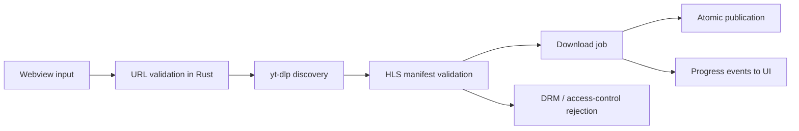

<div align="center">
  
  <h1>HighVi</h1>
  <p><strong>Ubuntu desktop download helper for permitted HTTPS video pages.</strong></p>
  <p>
    <a href="https://tauri.app/"></a>
    <a href="https://www.rust-lang.org/"></a>
    <a href="LICENSE"></a>
  </p>
</div>

HighVi is a small desktop app for Ubuntu that downloads permitted HLS media as MP4. It has two modes:

- **Page URL:** `yt-dlp` extracts a clear HLS playlist from a page it supports.
- **Direct HLS:** you paste a playlist URL and the page you found it on. HighVi sends that page as the `Referer`, the way a browser playing the video would.

## Safety and permission boundaries

- HighVi only accepts HTTPS page and playlist URLs and rejects empty, credentialed, local, private, and reserved targets before launching external tools.
- The app does not bypass DRM, sign-in, paywalls, or other access controls. Users must have permission to download the media they submit.
- `yt-dlp` is spawned with hermetic arguments: `--ignore-config`, `--no-plugin-dirs`, `--no-exec`, `--no-cookies`, and `--no-cookies-from-browser`. Its environment is cleared except for `PATH`, `HOME`, locale, `TMPDIR`, and proxy variables, and `YTDLP_NO_PLUGINS=1` is set. The app does not inherit personal browser sessions, `yt-dlp` config, or Python overrides from the user environment.
- The `Referer` is never a credential or a copied session. HighVi sends only the page origin (`https://site.example/`). `yt-dlp` applies one header to every request, including segments and keys on other hosts, where a browser would also send only the origin, so the page path and query never leave the app.
- The filename is validated before use and cannot contain path separators, reserved characters, or template variables.
- Download results are published to a fixed output directory in `~/Downloads/HighVi` with a no-overwrite rename on Linux.

## Current platform scope

This project is an Ubuntu desktop MVP. It is not a cross-platform web, Android, iOS, macOS, or Windows build.

## What HighVi does

The actual app flow in this repository is:

1. A user chooses a mode in the Tauri webview and enters either a page URL, or a playlist URL plus the page it came from.
2. Rust validates the URLs, blocks local/private network targets, and resolves the host it will contact before discovery continues.
3. Rust runs `yt-dlp` in discovery mode against the page (no `Referer`) or the playlist (with the page as `Referer`) and identifies a clear HLS playlist.
4. Rust rejects DRM-marked streams and validates the discovered HLS URL before the download begins. The UI only receives redacted URLs (`https://host/…/*.m3u8?…`); path segments, file names, and queries are masked.
5. The user triggers the download, and Rust re-discovers the playlist so it is not trusting stale URL data from the UI.
6. `yt-dlp` downloads the stream with its native HLS downloader, sends the `Referer` derived from the page, and emits structured progress events.
7. The completed file is staged in a per-job directory and published to `~/Downloads/HighVi` with an atomic no-overwrite rename.

## Prerequisites

HighVi is built for Ubuntu and expects the following system tools to be present:

- Rust
- Node.js
- `yt-dlp`
- FFmpeg
- Tauri v2 system libraries for GTK/WebKitGTK on Linux

Install the Linux packages required by Tauri v2:

```bash
sudo apt update
sudo apt install build-essential curl wget file libxdo-dev libssl-dev libayatana-appindicator3-dev librsvg2-dev libwebkit2gtk-4.1-dev
```

If `yt-dlp` is not available, install it from your distro or the upstream project, then confirm it is on `PATH`:

```bash
yt-dlp --version
ffmpeg -version
node --version
cargo --version
```

## Development and build commands

From the repository root:

```bash
npm install
npm run dev
npm run build
cargo test -p highvi-core --offline
cargo fmt --all -- --check
cargo clippy -p highvi-core --offline -- -D warnings
node --check ui/app.js
```

If the GTK and WebKitGTK development libraries are already installed, this Tauri app check can also run:

```bash
cargo check -p highvi --locked
```

## Verified flow



## Output location and no-overwrite behavior

Downloads are placed under:

```text
~/Downloads/HighVi
```

The application creates a temporary job directory, writes the completed file there, and publishes it with Linux `renameat2(..., RENAME_NOREPLACE)`. If the destination name already exists, HighVi stops instead of overwriting the user's file.

## Security design

The security model is described in [SECURITY.md](SECURITY.md). The app validates the initial page URL and the extracted HLS playlist URL before launch, and it runs `yt-dlp` with a restricted argument set. However, this is not a full SSRF defense for every child request made by `yt-dlp` itself. Redirects, segment URLs, and HLS key fetches can still be outside the app’s preflight DNS checks. HighVi forces `yt-dlp`'s native HLS downloader, but `yt-dlp` may still fall back to FFmpeg for streams the native downloader cannot handle. HighVi intentionally does not proxy or sandbox every downstream network request yet. The repo’s current guarantee is: block clearly public-inappropriate inputs up front, reject DRM and blocked access cases, and keep `yt-dlp` isolated from browser state.

## Repository layout

```text
.
├── Cargo.toml
├── LICENSE
├── README.md
├── SECURITY.md
├── package.json
├── src-tauri/
│   ├── Cargo.toml
│   ├── build.rs
│   ├── capabilities/
│   ├── gen/
│   ├── icons/
│   └── src/
├── crates/
│   └── highvi-core/
│       └── src/
├── ui/
│   ├── app.js
│   ├── index.html
│   └── styles.css
└── target/
```

## Troubleshooting

### `yt-dlp` is missing

```bash
yt-dlp --version
```

Install `yt-dlp` and confirm it is on your `PATH`.

### FFmpeg is missing

```bash
ffmpeg -version
```

HighVi relies on FFmpeg for the final MP4 remux step.

### GTK or WebKitGTK is missing

```bash
pkg-config --modversion webkit2gtk-4.1
```

If this fails, install the Tauri v2 Linux packages listed above before running the desktop app.

### HTTP 403 (`access_denied`, `host_firewall_block`)

The host refused the request. Common causes:

- **A playlist pasted as a page URL.** Many CDNs only serve playlists to the page that embeds them. Switch to Direct HLS and enter that page.
- **Wrong Referer page in Direct HLS.** Enter the page where you actually found the playlist.
- **Expired or signed playlist URL.** Copy a fresh one.
- **The host blocks automated clients or requires a browser session.** HighVi does not copy sessions or bypass bot protection, so this case is unsupported.

`yt-dlp` reports some of these as "Cloudflare anti-bot challenge" whenever a 403 body is a Cloudflare page. That text alone does not prove a browser challenge.

### Unsupported page or playlist (`unsupported_page`, `unsupported_playlist`)

`yt-dlp` has no extractor for the site and found no media in the page HTML. Pages that build their player with JavaScript are not supported. If you have the playlist URL and its page, use Direct HLS.

### No HLS format found

The page may not expose an HLS playlist, or the page may be behind an access control layer.

### The output filename already exists

Choose a different filename or delete the file in `~/Downloads/HighVi` before retrying. HighVi does not overwrite existing files.

## Roadmap

The following items are ideas for future work and are not implemented in this repository yet:

- stronger end-to-end network policy enforcement for every downstream HLS request
- additional UI validation and error states for file collisions and blocked hosts
- richer retry and recovery handling for transient `yt-dlp` errors
- broader testing with local fixture pages and media playlists
- additional platform support beyond the Ubuntu desktop MVP

## Contributing

Contributions are welcome if they are grounded in a clear reproduction and a minimal change.

Please include:

- sanitized reproduction steps
- the exact command or UI flow that triggered the issue
- the expected result and the actual result
- any error output after redaction

Do not include secrets, cookies, signed URLs, browser sessions, or copyrighted sample media in issues or pull requests.

## License

HighVi is available under the [MIT License](LICENSE).