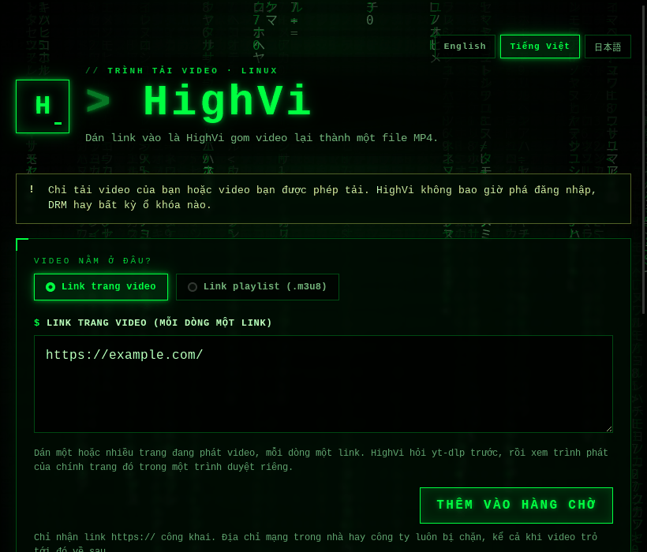
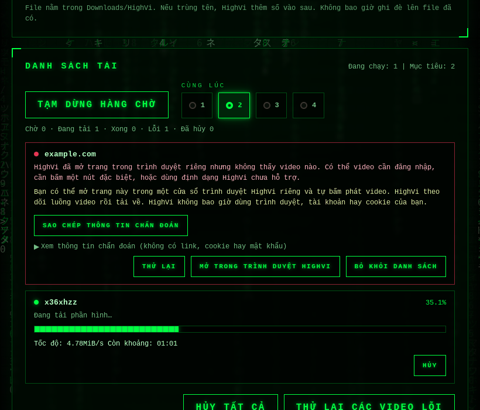
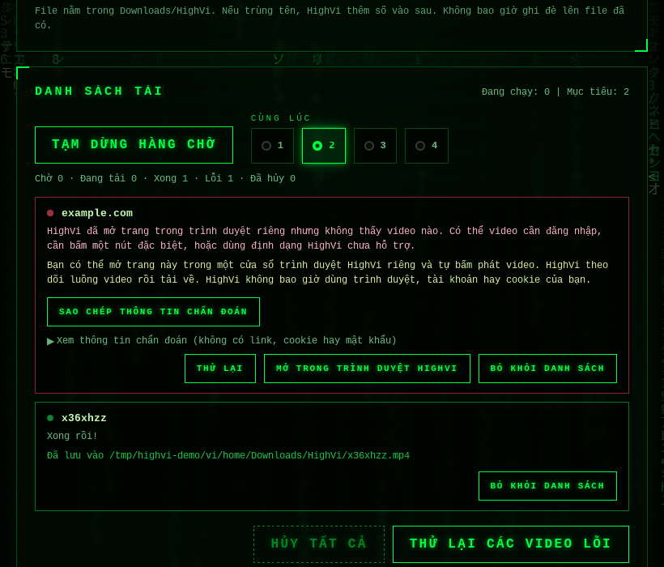
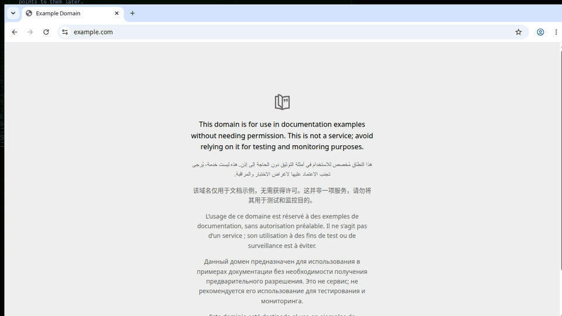
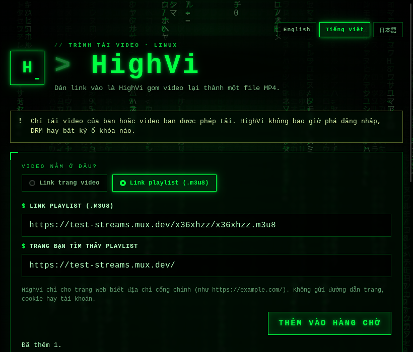

<div align="center">
  

  <p>
    <a href="README.md">English</a> ·
    <strong>Tiếng Việt</strong> ·
    <a href="README.ja.md">日本語</a>
  </p>

  <p>
    <a href="https://tauri.app/"></a>
    <a href="https://www.rust-lang.org/"></a>
    
    <a href="LICENSE"></a>
  </p>

  <p><code>&gt; tỉnh dậy đi... video đang chờ bạn_</code></p>
</div>

## 🟩 HighVi là gì?

Nhiều video trên mạng không phải là một file lớn. Chúng được cắt thành **rất nhiều mảnh nhỏ**, và có một danh sách nhỏ gọi là **playlist** (file có đuôi `.m3u8`) ghi lại chỗ của từng mảnh. Bạn cứ hình dung nó như một **tấm bản đồ kho báu**.

HighVi đọc tấm bản đồ đó, đi gom từng mảnh rồi ghép lại thành **một file MP4** để bạn xem ở đâu cũng được.

<div align="center">
  
  <br />
  <sub>Cửa sổ HighVi thật, chạy trên Ubuntu.</sub>
</div>

## 🕹️ Hai cách dùng

| Chế độ | Bạn dán vào | Dùng khi |
| --- | --- | --- |
| **Link trang video** | Link của trang có video | Gần như mọi trang: trang `yt-dlp` biết, và trang có trình phát dựng bằng JavaScript |
| **Link playlist (.m3u8)** | Link playlist **và** trang bạn tìm thấy nó | Bạn đã có sẵn link `.m3u8` |

HighVi nói được **English, Tiếng Việt và 日本語**. Bấm nút ở góc trên để chọn, HighVi sẽ nhớ lựa chọn của bạn.

**Sao chế độ “Link playlist” lại hỏi thêm trang web?**
Có những trang chỉ đưa bản đồ kho báu khi bạn nói mình đến từ đâu, giống như phải trình vé ở cửa. Lời nhắn đó gọi là **Referer**. HighVi chỉ nói địa chỉ "cổng chính" của trang (ví dụ `https://example.com/`). HighVi không bao giờ gửi phần còn lại của link, cookie hay tài khoản đăng nhập của bạn.

**Tải nhiều video một lúc?** Dán mỗi dòng một link (tối đa 100 link mỗi lần) rồi bấm **Bắt đầu tải**. HighVi tải tối đa **bốn** video cùng lúc; bạn chọn từ 1 đến 4. Mỗi dòng cho biết video đang ở bước nào, kể cả khi đang chờ trình duyệt riêng (mỗi lần chỉ mở một trang). Bạn có thể hủy, thử lại hoặc xóa từng dòng. Link đã có trong hàng chờ sẽ không bị thêm lần nữa.

**Có cần DevTools hay F12 không?** Không. Chỉ cần dán link trang. Nếu `yt-dlp` không biết trang đó, HighVi mở trang trong một Chrome riêng, dùng xong là bỏ (không dùng hồ sơ, không cookie của bạn, mọi request đều qua lớp bảo vệ mạng), để trình phát của chính trang tự tải, rồi chọn video chính chứ không phải quảng cáo. Chế độ **Link playlist** chỉ là đường lui nâng cao khi bạn đã có sẵn link `.m3u8`.

**Trang web từ chối HighVi?** Có những trang (thường đứng sau Cloudflare) chặn trình duyệt tự động chạy ẩn, nhưng vẫn cho trình duyệt bình thường xem. Khi đó dòng bị lỗi sẽ có nút **Mở trong trình duyệt HighVi**: một cửa sổ HighVi riêng, hiện ra để bạn tự bấm phát video (xem bên dưới).

## 🎬 Hướng dẫn

### 1. Lần tải đầu tiên

1. Mở HighVi. Giữ nguyên lựa chọn **Link trang video**.
2. Chép địa chỉ của trang đang phát video (trên thanh địa chỉ của trình duyệt) rồi dán vào ô.
3. Bấm **Thêm vào hàng chờ**. Ngay dưới ô, HighVi cho biết đã thêm bao nhiêu link.

<p align="center"><br /><sub>Link trang video, sẵn sàng thêm vào.</sub></p>
4. Kéo xuống phần **Danh sách tải** và bấm **Bắt đầu tải**. Dòng của video cho biết từng bước: đang tìm video, đang tải, đang ghép, đang lưu.

<p align="center"><br /><sub>Hai dòng: example.com không có video (xem phần 2); luồng thử nghiệm công khai đang tải, kèm tốc độ và thời gian còn lại.</sub></p>
5. Khi dòng báo **Đã lưu vào …**, bấm **Mở thư mục**. Video nằm trong `~/Downloads/HighVi`, đặt tên theo video.

<p align="center"><br /><sub>Xong: dòng cho biết file MP4 được lưu ở đâu.</sub></p>

Nhiều video? Ở bước 2, dán mỗi dòng một link, rồi chọn số video tải cùng lúc ở ô **Cùng lúc** (1–4).

### 2. Khi trang web từ chối HighVi

Có trang chặn trình duyệt ẩn của HighVi (dòng sẽ báo lỗi kiểu `host_firewall_block`, "Lớp bảo vệ của trang (Cloudflare) đã chặn HighVi").

1. Trên dòng đó, bấm **Mở trong trình duyệt HighVi**. Một cửa sổ HighVi riêng mở trang ra.

<p align="center"><br /><sub>Trình duyệt HighVi: một cửa sổ Chrome riêng, một tab. Trình duyệt, tài khoản và cookie của bạn không bao giờ được dùng.</sub></p>
2. Nếu trang bắt bạn xác nhận mình là người, hãy tự làm trong cửa sổ đó.
3. Bấm phát video như ở bất kỳ trình duyệt nào.
4. HighVi nhận ra luồng video, đóng cửa sổ, và việc tải tiếp tục ngay trên dòng đó.

Đổi ý? Đóng cửa sổ hoặc bấm **Hủy**. Nếu trang chặn cả cửa sổ này, HighVi không tải được từ trang đó.

### 3. Chế độ Link playlist (nâng cao)

Chỉ dùng khi bạn đã có sẵn link `.m3u8` của video:

1. Chọn **Link playlist (.m3u8)**.
2. Dán link `.m3u8` vào ô **Link playlist (.m3u8)**, và địa chỉ trang nơi bạn tìm thấy nó vào ô **Trang bạn tìm thấy playlist**.

<p align="center"><br /><sub>Chế độ Link playlist với một luồng thử nghiệm công khai và trang của nó.</sub></p>
3. Bấm **Thêm vào hàng chờ**, rồi **Bắt đầu tải**.

Có lỗi? Xem phần **Khi có lỗi** bên dưới. Trên dòng bị lỗi, **Sao chép thông tin chẩn đoán** chép một báo cáo ngắn (không có link, cookie hay mật khẩu) để gửi báo lỗi.

## ✅ HighVi làm gì

1. Bạn dán link rồi bấm **Tải MP4**.
2. HighVi kiểm tra đó là link `https://`, rồi bật một **lớp bảo vệ mạng** riêng: mọi request mà `yt-dlp` gửi đi (trang, redirect, playlist, từng mảnh, khóa) đều phải tới địa chỉ internet công khai. Máy trong mạng nhà hay mạng công ty luôn bị chặn.
3. `yt-dlp` tìm tấm bản đồ kho báu. Nếu không thấy, HighVi xem trình phát của chính trang trong một trình duyệt riêng để biết nó tải playlist nào. Sau đó HighVi chọn hình đẹp nhất (và phần tiếng nếu tách riêng).
4. Các mảnh được tải về và ghép thành một file MP4 ngay trên máy bạn. Bạn thấy tiến độ, tốc độ, thời gian còn lại, và có thể bấm **Hủy** bất cứ lúc nào.
5. Video xong nằm trong **`~/Downloads/HighVi`**, đặt theo tên video. Nếu trùng tên, HighVi thêm ` (2)`. Không bao giờ ghi đè. Bấm **Mở thư mục** để xem.

## 🧭 Dùng hàng chờ

1. Dán một hoặc nhiều link trang video, mỗi dòng một link (tối đa 100 link mỗi lần), rồi bấm **Thêm vào hàng chờ**. Link trùng hay không hợp lệ sẽ được liệt kê, không bị thêm vào.
2. Bấm **Bắt đầu tải**. Ô **Cùng lúc** cho chạy 1 đến 4 video một lúc; mặc định là 2. Giảm số này không bao giờ làm dừng video đang tải: các video dư sẽ tải xong trước.
3. Mỗi dòng cho biết đang ở bước nào: đang tìm video, *đang chờ trình duyệt riêng* (trang cần trình duyệt thì lần lượt từng trang), đang tải, *đang chờ ghép video*, đang lưu.
4. Mỗi dòng có **Hủy**, **Thử lại**, **Xóa**, và với trang mà cửa sổ hiện ra có thể giúp được thì có **Mở trong trình duyệt HighVi**. Cho cả hàng chờ: **Tạm dừng hàng chờ**, **Hủy tất cả**, **Thử lại các video lỗi**, **Xóa các video đã xong**.
5. Dòng bị lỗi có thể hiện thông tin chẩn đoán (các bước, mã lỗi, phiên bản công cụ, tên máy chủ; không bao giờ có link, cookie hay mật khẩu) để bạn chép vào báo lỗi.

Hàng chờ chỉ nằm trong bộ nhớ: đóng HighVi sẽ dừng các video đang tải (file đã xong vẫn còn) và xóa danh sách.

## 🌐 Mở trong trình duyệt HighVi

Khi một trang chặn trình duyệt ẩn của HighVi, hoặc trình phát cần bạn bấm phát, nút **Mở trong trình duyệt HighVi** sẽ mở trang đó trong một cửa sổ HighVi hiện ra:

1. Cửa sổ dùng một hồ sơ Chrome mới tinh, riêng cho đúng trang này. Đây không phải trình duyệt của bạn: không lịch sử, không đăng nhập, không cookie, không tiện ích, và bị xóa sau khi xong.
2. Dùng trang như bình thường và bấm phát video. HighVi theo dõi lưu lượng mạng của cửa sổ để tìm luồng video. Không cần DevTools, không cần chép link.
3. Ngay khi một luồng video qua được các bước kiểm tra của HighVi, cửa sổ đóng lại và việc tải tiếp tục trong hàng chờ như bình thường. Quảng cáo hay đoạn xem trước không qua được kiểm tra thì không làm cửa sổ đóng.

- Lưu lượng web của cửa sổ vẫn đi qua lớp bảo vệ mạng của HighVi (chỉ địa chỉ `https://` công khai), và sandbox của Chrome vẫn bật. Link mà nó định chuyển cho ứng dụng khác (`mailto:`, `magnet:`, …) sẽ không đi đâu cả, và tải file lên bị tắt.
- HighVi không bao giờ tự bấm phát hay bấm gì thay bạn trong cửa sổ.
- Cửa sổ chờ tối đa 10 phút. Mỗi lần chỉ có một trình duyệt HighVi: nếu trang khác đang dùng, cửa sổ sẽ mở khi trình duyệt rảnh. Các video không cần trình duyệt vẫn tải tiếp.
- Đóng cửa sổ là kết thúc lần thử đó (`browser_closed`). Nút **Hủy** cũng dùng được.
- Đây là một cửa sổ desktop bình thường: nó dùng chung clipboard như mọi ứng dụng, và trên X11 (không phải Wayland), các ứng dụng trên cùng màn hình có thể thấy cửa sổ của nhau.

> [!NOTE]
> Trang web vẫn có thể từ chối cả trình duyệt hiện ra, hoặc bắt bạn chứng minh mình là người. HighVi không bao giờ trả lời các bước kiểm tra đó thay bạn. Nếu trang cho bạn vào, đó là vì bạn được phép, chứ không phải vì HighVi lách qua được gì.

## 🛑 Những điều HighVi không bao giờ làm

- Phá DRM, tường phí hay chuyện đăng nhập.
- Dùng cookie hay phiên đăng nhập trên trình duyệt của bạn.
- Giả làm trình duyệt để lách qua chặn bot.
- Chạy plugin hay lệnh phụ từ cấu hình `yt-dlp` của bạn.
- Tự giải các bước kiểm tra bot hay CAPTCHA, hoặc chép cookie từ trình duyệt của chính bạn.

## 🔒 Riêng tư và an toàn

- **Không có gì rời khỏi máy bạn ngoài chính video được tải.** HighVi không có tài khoản, không gửi số liệu sử dụng, không tự kiểm tra cập nhật.
- **Link chỉ nằm trong HighVi.** Link video có chữ ký không bao giờ tới giao diện của HighVi, nhật ký, hay dòng lệnh của chương trình khác. Video đã lưu không mang link hay tag nguồn.
- **Một lớp bảo vệ cho mọi lưu lượng.** `yt-dlp` và trình duyệt chỉ ra được các địa chỉ `https://` công khai, qua lớp bảo vệ mạng của HighVi. Mạng ở nhà hay ở công ty của bạn thì chúng không với tới được.
- **Chỗ làm việc dùng xong là bỏ.** Mỗi lần tải dùng một thư mục riêng (`~/Downloads/HighVi/.highvi-job-…`, quyền `0700`), bị xóa khi xong, và cả sau khi app bị sập, lúc HighVi mở lại. Nếu HighVi bị tắt ngang, các công cụ của nó cũng dừng theo.
- **Không bất ngờ trên ổ đĩa.** HighVi không bao giờ ghi đè file; trùng tên thì thêm ` (2)`.
- **Thông tin chẩn đoán là của bạn.** Chỉ hiện khi bạn yêu cầu, và không bao giờ được gửi đi đâu.

> [!IMPORTANT]
> Chỉ tải video của bạn hoặc video bạn được phép tải.

## 🚀 Bắt đầu

Bạn cần **Ubuntu**, **Rust**, **Node.js**, **`yt-dlp`** và **FFmpeg**. **Google Chrome hoặc Chromium** là tuỳ chọn: thiếu nó thì không tìm được video trên trang có trình phát dựng bằng JavaScript.

Cài các thư viện hệ thống mà Tauri cần:

```bash
sudo apt update
sudo apt install build-essential curl wget file libxdo-dev libssl-dev \
  libayatana-appindicator3-dev librsvg2-dev libwebkit2gtk-4.1-dev ffmpeg
```

Cài `yt-dlp` **bản 2025.11.12 trở lên** (HighVi được thử với 2026.03.17 và 2026.08.19), và nhớ cập nhật thường xuyên. Gói của Ubuntu 26.04 là đủ mới; **gói của Ubuntu 24.04 thì không** (2024.04.09). Trên 24.04, hãy cài bằng pipx, rồi **đăng xuất và đăng nhập lại** để máy tìm thấy bản mới trước:

```bash
sudo apt install pipx && pipx install yt-dlp
```

Sau đó kiểm tra lại:

```bash
yt-dlp --version && ffmpeg -version && node --version && cargo --version
```

Chạy ứng dụng:

```bash
npm install
npm run dev     # mở HighVi
npm run build   # đóng gói .deb và AppImage
```

## 📦 Cài đặt, nâng cấp, gỡ bỏ

Hiện chưa có bản phát hành sẵn; hãy tự đóng gói (xem **Bắt đầu**).

**Cài file `.deb`** (Ubuntu/Debian; tự cài kèm `yt-dlp` và FFmpeg):

```bash
sudo apt install ./target/release/bundle/deb/HighVi_0.1.0_amd64.deb
```

Trên Ubuntu 24.04, cài thêm `yt-dlp` mới bằng pipx (xem **Bắt đầu**). Muốn tìm video trên trang có trình phát dựng bằng JavaScript, và để dùng **Mở trong trình duyệt HighVi**, hãy cài Google Chrome hoặc Chromium; bản Chromium snap của Ubuntu cũng dùng được.

**Nâng cấp** lên bản mới hơn: cài file `.deb` mới y như trên. Nếu số phiên bản không đổi, thêm `--reinstall`, không thì apt giữ bản cũ:

```bash
sudo apt install --reinstall ./target/release/bundle/deb/HighVi_0.1.0_amd64.deb
```

**Gỡ cài đặt**: `sudo apt remove high-vi`. Video của bạn trong `~/Downloads/HighVi` vẫn được giữ.

**AppImage** (cần có sẵn `yt-dlp` và FFmpeg trong `PATH`):

```bash
chmod +x target/release/bundle/appimage/HighVi_0.1.0_amd64.AppImage
./target/release/bundle/appimage/HighVi_0.1.0_amd64.AppImage
```

Nếu nó báo lỗi FUSE, chạy với `APPIMAGE_EXTRACT_AND_RUN=1`.

Video được lưu ở **`~/Downloads/HighVi`** (hoặc `Downloads/HighVi` trong thư mục Tải xuống theo ngôn ngữ máy bạn).

## 🧯 Khi có lỗi

| Mã lỗi | Nghĩa là gì | Thử làm gì |
| --- | --- | --- |
| `access_denied` / `host_firewall_block` | Trang web **từ chối** (HTTP 403). | Nếu bạn dán link `.m3u8` vào ô link trang video, hãy chuyển sang **Link playlist** và thêm trang chứa nó. Xem lại trang đã đúng chưa, hoặc lấy link playlist mới. Nếu trang bắt đăng nhập bằng trình duyệt thì HighVi đành chịu. |
| `unsupported_page` | `yt-dlp` không biết trang này, và máy chưa có trình duyệt để tìm tiếp. | Cài Google Chrome hoặc Chromium, hoặc dùng **Link playlist**. |
| `no_media_found` | Trình duyệt riêng đã mở trang nhưng không thấy video nào tải về. | Có thể trình phát cần đăng nhập hay một nút đặc biệt. HighVi không lách qua những thứ đó. |
| `browser_failed` | Trình duyệt riêng bị dừng bất ngờ. | Thử lại nhé. |
| `unsupported_playlist` | Link này không phải playlist mà HighVi đọc được. | Kiểm tra đó đúng là link `.m3u8`. |
| `media_not_found` | Video không còn nữa (HTTP 404/410). | Link có thể đã hết hạn, hãy lấy link mới. |
| `drm_not_supported` | Video bị khóa bằng DRM. | HighVi sẽ không mở khóa. |
| `authentication_required` | Phải đăng nhập mới xem được. | HighVi không dùng tài khoản của bạn. |
| `network_timeout` | Trang web trả lời quá lâu. | Thử lại sau nhé. |
| `unsafe_network_target` | Video định kết nối tới máy trong mạng nhà hay mạng công ty. | HighVi cố ý chặn lại. |
| `live_not_supported` | Đây là phát trực tiếp. | HighVi chỉ tải video đã phát xong. |
| `missing_dependency` | Chưa cài `yt-dlp` hoặc FFmpeg. | Cài vào rồi thử lại. |
| `ytdlp_too_old` | `yt-dlp` của bạn cũ hơn 2025.11.12, không chạy được các thiết lập an toàn của HighVi. | Cài bản mới bằng pipx (xem **Bắt đầu**), rồi đăng xuất và đăng nhập lại. |
| `rate_limited` | Trang web báo bạn hỏi quá nhiều lần (HTTP 429). | Đợi một lúc, và tải ít video cùng lúc hơn. |
| `media_access_denied` | Đã tìm thấy trang, nhưng máy chủ video **từ chối** (HTTP 403). | Thường là do `yt-dlp` cũ: hãy cập nhật. Có trang chỉ cho trình phát của chính nó tải. |
| `download_stalled` | Việc tải đứng yên suốt 2 phút. | Thử lại sau. |
| `download_timeout` | Một phần tải lâu hơn 24 giờ. | Thử lại với mạng nhanh hơn. |
| `insufficient_disk_space` | Không đủ chỗ trống cho video. | Dọn bớt rồi thử lại. |
| `discovery_overloaded` | Trang gửi quá nhiều request, trình duyệt riêng không theo dõi kịp. | Dùng **Link playlist** nếu bạn có link `.m3u8`. |
| `browser_closed` | Cửa sổ trình duyệt HighVi bị đóng trước khi video bắt đầu phát. | Mở lại và bấm phát video trong đó, hoặc để nguyên dòng đó. |
| `interactive_timeout` | Không có video nào được phát trong cửa sổ trình duyệt HighVi trong 10 phút. | Mở lại; bấm phát video trong cửa sổ. |
| `browser_no_display` | HighVi không tìm thấy màn hình desktop để mở cửa sổ trình duyệt. | Chạy HighVi từ phiên desktop bình thường của bạn. |
| `queue_full` / `batch_too_large` | Hàng chờ chứa tối đa 200 video, mỗi lần thêm tối đa 100 link. | Xóa các dòng đã xong, hoặc thêm ít link hơn. |

## ❓ Hỏi đáp

**Sao trang phát được trong Chrome của tôi mà HighVi lại lỗi?** Thường là do trang chặn trình duyệt tự động chạy ẩn (bạn sẽ thấy `host_firewall_block` hoặc `access_denied`). Hãy dùng **Mở trong trình duyệt HighVi**. Nếu trang chặn cả cửa sổ đó, HighVi không tải được từ trang này.

**Mở trong trình duyệt HighVi có dùng hồ sơ Chrome, mật khẩu hay cookie của tôi không?** Không. Đó là một hồ sơ riêng, trống trơn, và bị xóa sau khi xong. HighVi không bao giờ đọc dữ liệu trình duyệt của bạn.

**YouTube báo lỗi 403.** `yt-dlp` của bạn quá cũ với YouTube (cần bản 2026.08.19 trở lên). Cập nhật như ở phần **Bắt đầu**.

**Có chạy được trên Wayland không? Màn hình HiDPI thì sao?** Có. HighVi và cửa sổ trình duyệt của nó chạy trực tiếp trên Wayland lẫn X11, và co giãn theo màn hình.

**Tải được bao nhiêu video cùng lúc?** Tối đa bốn; bạn chọn từ 1 đến 4. Trang nào cần trình duyệt thì dùng lần lượt từng trang.

**Có tải được video có DRM hay video phát trực tiếp không?** Không, và HighVi cũng không bao giờ thử.

## 🚧 Giới hạn hiện tại

- **Chỉ HLS và MP4 thường.** Trang chỉ có DASH, phát trực tiếp và video có DRM sẽ bị từ chối, cố ý vậy.
- **Không đăng nhập, không cookie.** Video cần đăng nhập, hoặc cần cookie mà trang đặt cho trình phát, sẽ không tải được. HighVi không bao giờ mượn phiên trình duyệt của bạn.
- **Tìm bằng trình duyệt và Mở trong trình duyệt HighVi cần Google Chrome hoặc Chromium.** HighVi không kèm trình duyệt. Bản Chromium dạng snap của Ubuntu cũng dùng được (mọi bài kiểm thử trình duyệt đều đạt với Chromium 155 bản snap).
- **Trang web vẫn có thể từ chối cả cửa sổ trình duyệt HighVi** (kiểm tra bot, bắt đăng nhập, chặn theo vùng). HighVi báo lại điều đó, chứ không lách qua.
- **Trình phát cần bấm nút đặc biệt** (lớp “play” riêng, hỏi tuổi, hỏi đồng ý cookie) sẽ không được bấm. HighVi chỉ bật các thẻ `<video>` bình thường.
- **Không dùng proxy hệ thống hay proxy công ty.** Lớp bảo vệ mạng của HighVi là lối ra duy nhất. Nếu mạng chặn kết nối trực tiếp thì sẽ không tải được.
- **Media dùng `http://` bị từ chối,** kể cả khi trang là `https://`.
- **Chỉ Linux.** Đã thử trên Ubuntu 26.04 với Google Chrome 153/154, yt-dlp 2026.03.17 và 2026.08.19, FFmpeg 8. Trên Ubuntu 24.04 mới chỉ kiểm tra việc cài và mở gói `.deb`. Trên Wayland mới chỉ kiểm tra việc khởi động và hiển thị sắc nét trên màn hình HiDPI.
- **Tối đa bốn video cùng lúc,** và mỗi lần chỉ một trang trong trình duyệt riêng. Hàng chờ mất khi đóng HighVi.
- **URL media rất dài (trên 8 KiB) thấy trong trình duyệt sẽ bị bỏ qua.**

## 🧠 Dành cho lập trình viên

Kiến trúc, quy trình và các giới hạn: [docs/ARCHITECTURE.md](docs/ARCHITECTURE.md).

```bash
HIGHVI_REQUIRE_E2E=1 cargo test --workspace --offline
cargo clippy --workspace --all-targets --offline -- -D warnings
cargo fmt --all -- --check
node --check ui/app.js && node --check ui/i18n.js && node --check ui/rain.js
node scripts/check-ui.mjs   # translation parity
```

```text
crates/highvi-core/   Lớp bảo vệ mạng (egress proxy), tìm video, chọn format, job tải, ghép MP4, lưu file an toàn
                      (unit test + test end-to-end với yt-dlp/FFmpeg thật và server HTTPS cục bộ)
src-tauri/            Lệnh Tauri: hàng chờ tải, sự kiện tiến độ, mở thư mục
ui/                   Cửa sổ màu xanh: index.html, styles.css, app.js, i18n.js (English · Tiếng Việt · 日本語), rain.js
docs/assets/          Banner và ảnh chụp màn hình cho README
```

Cách HighVi giữ an toàn cho bạn và các giới hạn hiện tại được viết trong [SECURITY.md](SECURITY.md). Nói gọn: mọi request mà công cụ của HighVi gửi đi đều phải qua lớp bảo vệ chỉ cho phép địa chỉ HTTPS công khai, và FFmpeg không bao giờ ra mạng.

## 📜 Giấy phép

[MIT](LICENSE)

<div align="center"><sub><code>không có cái thìa nào cả — chỉ có các mảnh video_</code></sub></div>
