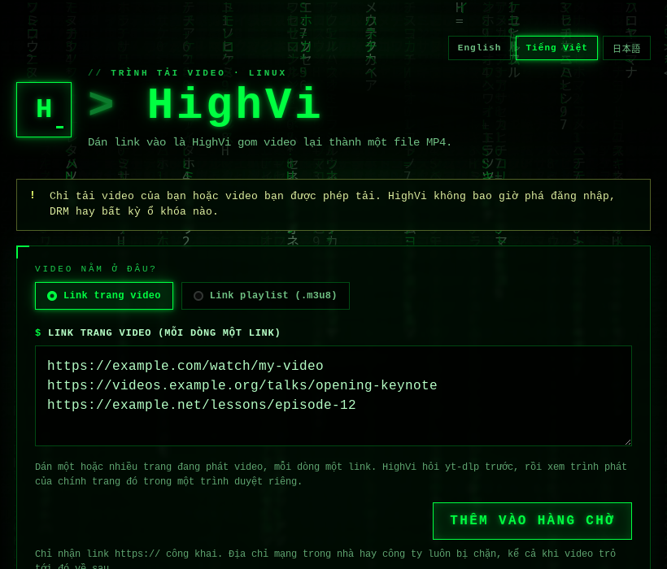

<div align="center">
  

  <p>
    <a href="README.md">English</a> ·
    <strong>Tiếng Việt</strong> ·
    <a href="README.ja.md">日本語</a>
  </p>

  <p>
    <a href="https://tauri.app/"></a>
    <a href="https://www.rust-lang.org/"></a>
    
    <a href="LICENSE"></a>
  </p>

  <p><code>&gt; tỉnh dậy đi... video đang chờ bạn_</code></p>
</div>

## 🟩 HighVi là gì?

Nhiều video trên mạng không phải là một file lớn. Chúng được cắt thành **rất nhiều mảnh nhỏ**, và có một danh sách nhỏ gọi là **playlist** (file có đuôi `.m3u8`) ghi lại chỗ của từng mảnh. Bạn cứ hình dung nó như một **tấm bản đồ kho báu**.

HighVi đọc tấm bản đồ đó, đi gom từng mảnh rồi ghép lại thành **một file MP4** để bạn xem ở đâu cũng được.

<div align="center">
  
  <br />
  <sub>Cửa sổ HighVi thật, chạy trên Ubuntu.</sub>
</div>

## 🕹️ Hai cách dùng

| Chế độ | Bạn dán vào | Dùng khi |
| --- | --- | --- |
| **Link trang video** | Link của trang có video | Gần như mọi trang: trang `yt-dlp` biết, và trang có trình phát dựng bằng JavaScript |
| **Link playlist (.m3u8)** | Link playlist **và** trang bạn tìm thấy nó | Bạn đã có sẵn link `.m3u8` |

HighVi nói được **English, Tiếng Việt và 日本語**. Bấm nút ở góc trên để chọn, HighVi sẽ nhớ lựa chọn của bạn.

**Sao chế độ “Link playlist” lại hỏi thêm trang web?**
Có những trang chỉ đưa bản đồ kho báu khi bạn nói mình đến từ đâu, giống như phải trình vé ở cửa. Lời nhắn đó gọi là **Referer**. HighVi chỉ nói địa chỉ "cổng chính" của trang (ví dụ `https://example.com/`). HighVi không bao giờ gửi phần còn lại của link, cookie hay tài khoản đăng nhập của bạn.

**Tải nhiều video một lúc?** Dán mỗi dòng một link (tối đa 100 link mỗi lần) rồi bấm **Bắt đầu tải**. HighVi tải tối đa **bốn** video cùng lúc; bạn chọn từ 1 đến 4. Mỗi dòng cho biết video đang ở bước nào, kể cả khi đang chờ trình duyệt riêng (mỗi lần chỉ mở một trang). Bạn có thể hủy, thử lại hoặc xóa từng dòng. Link đã có trong hàng chờ sẽ không bị thêm lần nữa.

**Có cần DevTools hay F12 không?** Không. Chỉ cần dán link trang. Nếu `yt-dlp` không biết trang đó, HighVi mở trang trong một Chrome riêng, dùng xong là bỏ (không dùng hồ sơ, không cookie của bạn, mọi request đều qua lớp bảo vệ mạng), để trình phát của chính trang tự tải, rồi chọn video chính chứ không phải quảng cáo. Chế độ **Link playlist** chỉ là đường lui nâng cao khi bạn đã có sẵn link `.m3u8`.

## ✅ HighVi làm gì

1. Bạn dán link rồi bấm **Tải MP4**.
2. HighVi kiểm tra đó là link `https://`, rồi bật một **lớp bảo vệ mạng** riêng: mọi request mà `yt-dlp` gửi đi (trang, redirect, playlist, từng mảnh, khóa) đều phải tới địa chỉ internet công khai. Máy trong mạng nhà hay mạng công ty luôn bị chặn.
3. `yt-dlp` tìm tấm bản đồ kho báu. Nếu không thấy, HighVi xem trình phát của chính trang trong một trình duyệt riêng để biết nó tải playlist nào. Sau đó HighVi chọn hình đẹp nhất (và phần tiếng nếu tách riêng).
4. Các mảnh được tải về và ghép thành một file MP4 ngay trên máy bạn. Bạn thấy tiến độ, tốc độ, thời gian còn lại, và có thể bấm **Hủy** bất cứ lúc nào.
5. Video xong nằm trong **`~/Downloads/HighVi`**, đặt theo tên video. Nếu trùng tên, HighVi thêm ` (2)`. Không bao giờ ghi đè. Bấm **Mở thư mục** để xem.

## 🛑 Những điều HighVi không bao giờ làm

- Phá DRM, tường phí hay chuyện đăng nhập.
- Dùng cookie hay phiên đăng nhập trên trình duyệt của bạn.
- Giả làm trình duyệt để lách qua chặn bot.
- Chạy plugin hay lệnh phụ từ cấu hình `yt-dlp` của bạn.

> [!IMPORTANT]
> Chỉ tải video của bạn hoặc video bạn được phép tải.

## 🚀 Bắt đầu

Bạn cần **Ubuntu**, **Rust**, **Node.js**, **`yt-dlp`** và **FFmpeg**. **Google Chrome hoặc Chromium** là tuỳ chọn: thiếu nó thì không tìm được video trên trang có trình phát dựng bằng JavaScript.

Cài các thư viện hệ thống mà Tauri cần:

```bash
sudo apt update
sudo apt install build-essential curl wget file libxdo-dev libssl-dev \
  libayatana-appindicator3-dev librsvg2-dev libwebkit2gtk-4.1-dev ffmpeg
```

Cài `yt-dlp` **bản 2025.11.12 trở lên** (HighVi được thử với 2026.03.17 và 2026.08.19), và nhớ cập nhật thường xuyên. Gói của Ubuntu 26.04 là đủ mới; **gói của Ubuntu 24.04 thì không** (2024.04.09). Trên 24.04, hãy cài bằng pipx, rồi **đăng xuất và đăng nhập lại** để máy tìm thấy bản mới trước:

```bash
sudo apt install pipx && pipx install yt-dlp
```

Sau đó kiểm tra lại:

```bash
yt-dlp --version && ffmpeg -version && node --version && cargo --version
```

Chạy ứng dụng:

```bash
npm install
npm run dev     # mở HighVi
npm run build   # đóng gói .deb và AppImage
```

## 📦 Cài đặt

Hiện chưa có bản phát hành sẵn; hãy tự đóng gói (xem **Bắt đầu**), rồi:

```bash
# .deb (Ubuntu/Debian): tự cài kèm yt-dlp và FFmpeg
# (trên Ubuntu 24.04, cài thêm yt-dlp mới bằng pipx: xem Bắt đầu)
sudo apt install ./target/release/bundle/deb/HighVi_0.1.0_amd64.deb

# hoặc AppImage (cần có sẵn yt-dlp và FFmpeg trong PATH)
chmod +x target/release/bundle/appimage/HighVi_0.1.0_amd64.AppImage
./target/release/bundle/appimage/HighVi_0.1.0_amd64.AppImage
```

Nếu AppImage báo lỗi FUSE, chạy với `APPIMAGE_EXTRACT_AND_RUN=1`. Muốn tìm video trên trang có trình phát dựng bằng JavaScript thì cài thêm Google Chrome hoặc Chromium.

## 🧯 Khi có lỗi

| Mã lỗi | Nghĩa là gì | Thử làm gì |
| --- | --- | --- |
| `access_denied` / `host_firewall_block` | Trang web **từ chối** (HTTP 403). | Nếu bạn dán link `.m3u8` vào ô link trang video, hãy chuyển sang **Link playlist** và thêm trang chứa nó. Xem lại trang đã đúng chưa, hoặc lấy link playlist mới. Nếu trang bắt đăng nhập bằng trình duyệt thì HighVi đành chịu. |
| `unsupported_page` | `yt-dlp` không biết trang này, và máy chưa có trình duyệt để tìm tiếp. | Cài Google Chrome hoặc Chromium, hoặc dùng **Link playlist**. |
| `no_media_found` | Trình duyệt riêng đã mở trang nhưng không thấy video nào tải về. | Có thể trình phát cần đăng nhập hay một nút đặc biệt. HighVi không lách qua những thứ đó. |
| `browser_failed` | Trình duyệt riêng bị dừng bất ngờ. | Thử lại nhé. |
| `unsupported_playlist` | Link này không phải playlist mà HighVi đọc được. | Kiểm tra đó đúng là link `.m3u8`. |
| `media_not_found` | Video không còn nữa (HTTP 404/410). | Link có thể đã hết hạn, hãy lấy link mới. |
| `drm_not_supported` | Video bị khóa bằng DRM. | HighVi sẽ không mở khóa. |
| `authentication_required` | Phải đăng nhập mới xem được. | HighVi không dùng tài khoản của bạn. |
| `network_timeout` | Trang web trả lời quá lâu. | Thử lại sau nhé. |
| `unsafe_network_target` | Video định kết nối tới máy trong mạng nhà hay mạng công ty. | HighVi cố ý chặn lại. |
| `live_not_supported` | Đây là phát trực tiếp. | HighVi chỉ tải video đã phát xong. |
| `missing_dependency` | Chưa cài `yt-dlp` hoặc FFmpeg. | Cài vào rồi thử lại. |
| `ytdlp_too_old` | `yt-dlp` của bạn cũ hơn 2025.11.12, không chạy được các thiết lập an toàn của HighVi. | Cài bản mới bằng pipx (xem **Bắt đầu**), rồi đăng xuất và đăng nhập lại. |
| `rate_limited` | Trang web báo bạn hỏi quá nhiều lần (HTTP 429). | Đợi một lúc, và tải ít video cùng lúc hơn. |
| `media_access_denied` | Đã tìm thấy trang, nhưng máy chủ video **từ chối** (HTTP 403). | Thường là do `yt-dlp` cũ: hãy cập nhật. Có trang chỉ cho trình phát của chính nó tải. |
| `download_stalled` | Việc tải đứng yên suốt 2 phút. | Thử lại sau. |
| `download_timeout` | Một phần tải lâu hơn 24 giờ. | Thử lại với mạng nhanh hơn. |
| `insufficient_disk_space` | Không đủ chỗ trống cho video. | Dọn bớt rồi thử lại. |
| `discovery_overloaded` | Trang gửi quá nhiều request, trình duyệt riêng không theo dõi kịp. | Dùng **Link playlist** nếu bạn có link `.m3u8`. |
| `queue_full` / `batch_too_large` | Hàng chờ chứa tối đa 200 video, mỗi lần thêm tối đa 100 link. | Xóa các dòng đã xong, hoặc thêm ít link hơn. |

## 🚧 Giới hạn hiện tại

- **Chỉ HLS và MP4 thường.** Trang chỉ có DASH, phát trực tiếp và video có DRM sẽ bị từ chối, cố ý vậy.
- **Không đăng nhập, không cookie.** Video cần đăng nhập, hoặc cần cookie mà trang đặt cho trình phát, sẽ không tải được. HighVi không bao giờ mượn phiên trình duyệt của bạn.
- **Tìm bằng trình duyệt cần Google Chrome hoặc Chromium.** HighVi không kèm trình duyệt. Bản Chromium dạng snap của Ubuntu cũng dùng được (mọi bài kiểm thử trình duyệt đều đạt với Chromium 155 bản snap).
- **Trình phát cần bấm nút đặc biệt** (lớp “play” riêng, hỏi tuổi, hỏi đồng ý cookie) sẽ không được bấm. HighVi chỉ bật các thẻ `<video>` bình thường.
- **Không dùng proxy hệ thống hay proxy công ty.** Lớp bảo vệ mạng của HighVi là lối ra duy nhất. Nếu mạng chặn kết nối trực tiếp thì sẽ không tải được.
- **Media dùng `http://` bị từ chối,** kể cả khi trang là `https://`.
- **Chỉ Linux.** Đã thử trên Ubuntu 26.04 với Google Chrome 153/154, yt-dlp 2026.03.17 và 2026.08.19, FFmpeg 8. Trên Ubuntu 24.04 mới chỉ kiểm tra việc cài và mở gói `.deb`. Trên Wayland mới chỉ kiểm tra việc khởi động và hiển thị sắc nét trên màn hình HiDPI.
- **Tối đa bốn video cùng lúc,** và mỗi lần chỉ một trang trong trình duyệt riêng. Hàng chờ mất khi đóng HighVi.
- **URL media rất dài (trên 8 KiB) thấy trong trình duyệt sẽ bị bỏ qua.**

## 🧠 Dành cho lập trình viên

Kiến trúc, quy trình và các giới hạn: [docs/ARCHITECTURE.md](docs/ARCHITECTURE.md).

```bash
HIGHVI_REQUIRE_E2E=1 cargo test --workspace --offline
cargo clippy --workspace --all-targets --offline -- -D warnings
cargo fmt --all -- --check
node --check ui/app.js && node --check ui/i18n.js && node --check ui/rain.js
node scripts/check-ui.mjs   # translation parity
```

```text
crates/highvi-core/   Lớp bảo vệ mạng (egress proxy), tìm video, chọn format, job tải, ghép MP4, lưu file an toàn
                      (unit test + test end-to-end với yt-dlp/FFmpeg thật và server HTTPS cục bộ)
src-tauri/            Lệnh Tauri: hàng chờ tải, sự kiện tiến độ, mở thư mục
ui/                   Cửa sổ màu xanh: index.html, styles.css, app.js, i18n.js (English · Tiếng Việt · 日本語), rain.js
docs/assets/          Banner và ảnh chụp màn hình cho README
```

Cách HighVi giữ an toàn cho bạn và các giới hạn hiện tại được viết trong [SECURITY.md](SECURITY.md). Nói gọn: mọi request mà công cụ của HighVi gửi đi đều phải qua lớp bảo vệ chỉ cho phép địa chỉ HTTPS công khai, và FFmpeg không bao giờ ra mạng.

## 📜 Giấy phép

[MIT](LICENSE)

<div align="center"><sub><code>không có cái thìa nào cả — chỉ có các mảnh video_</code></sub></div>
