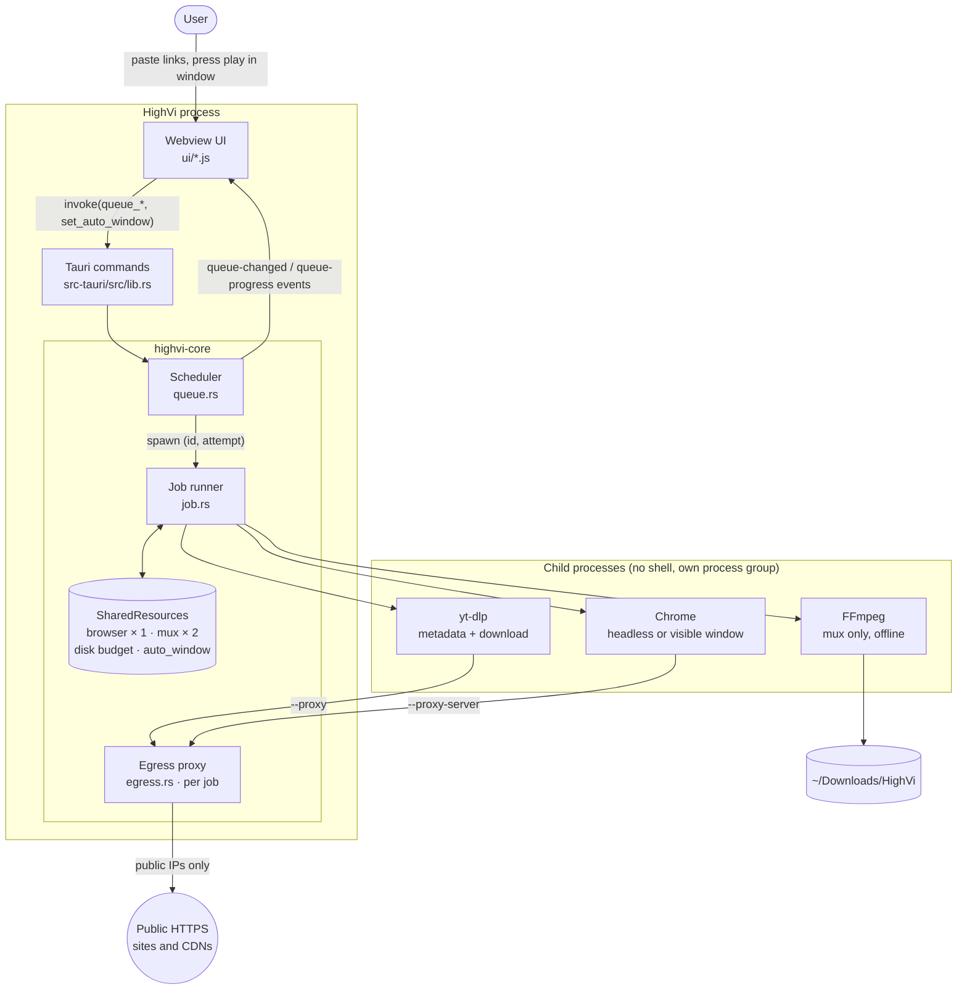
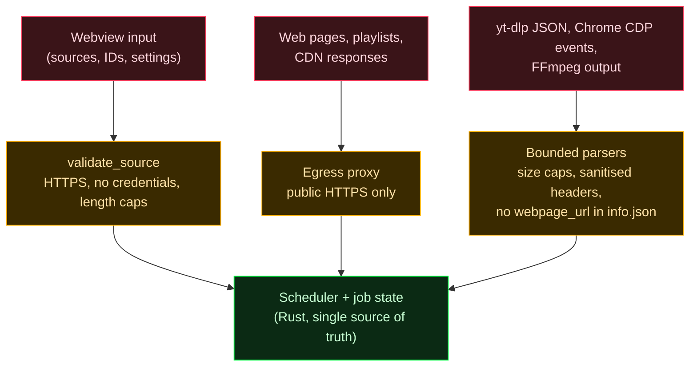
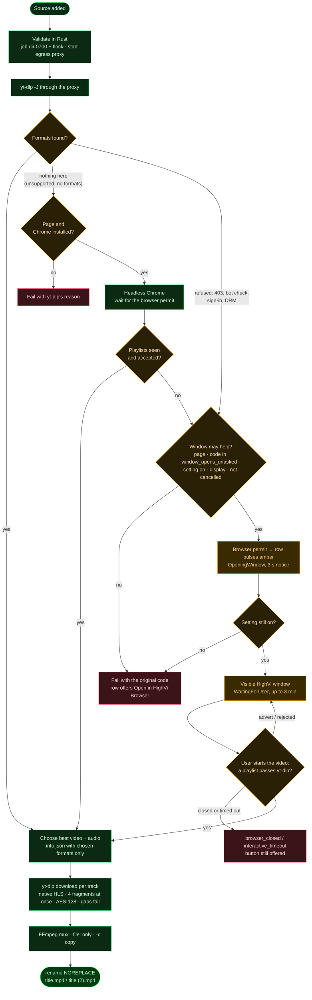
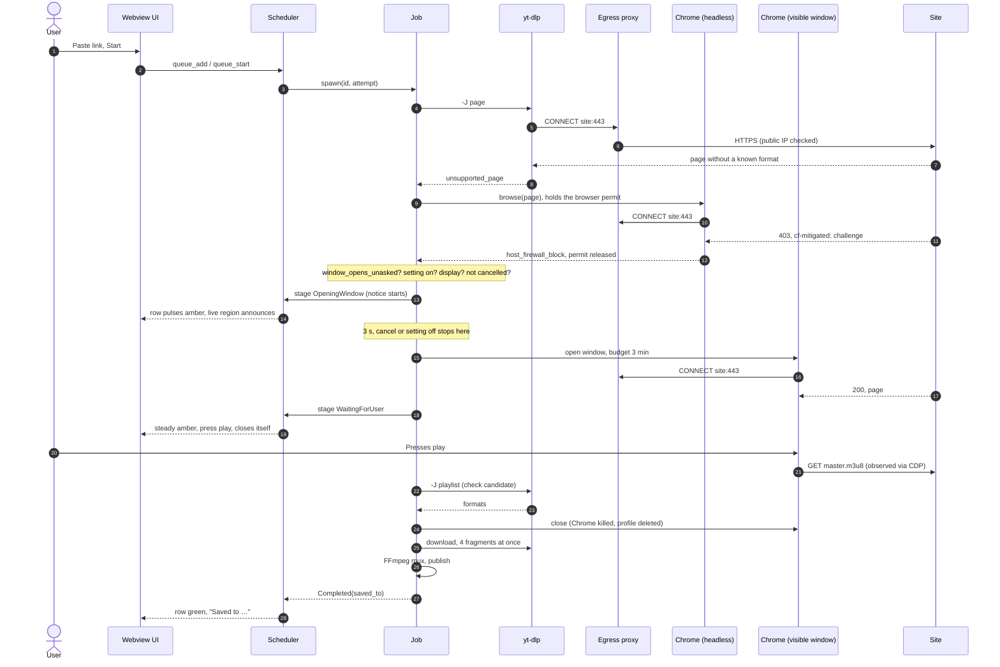
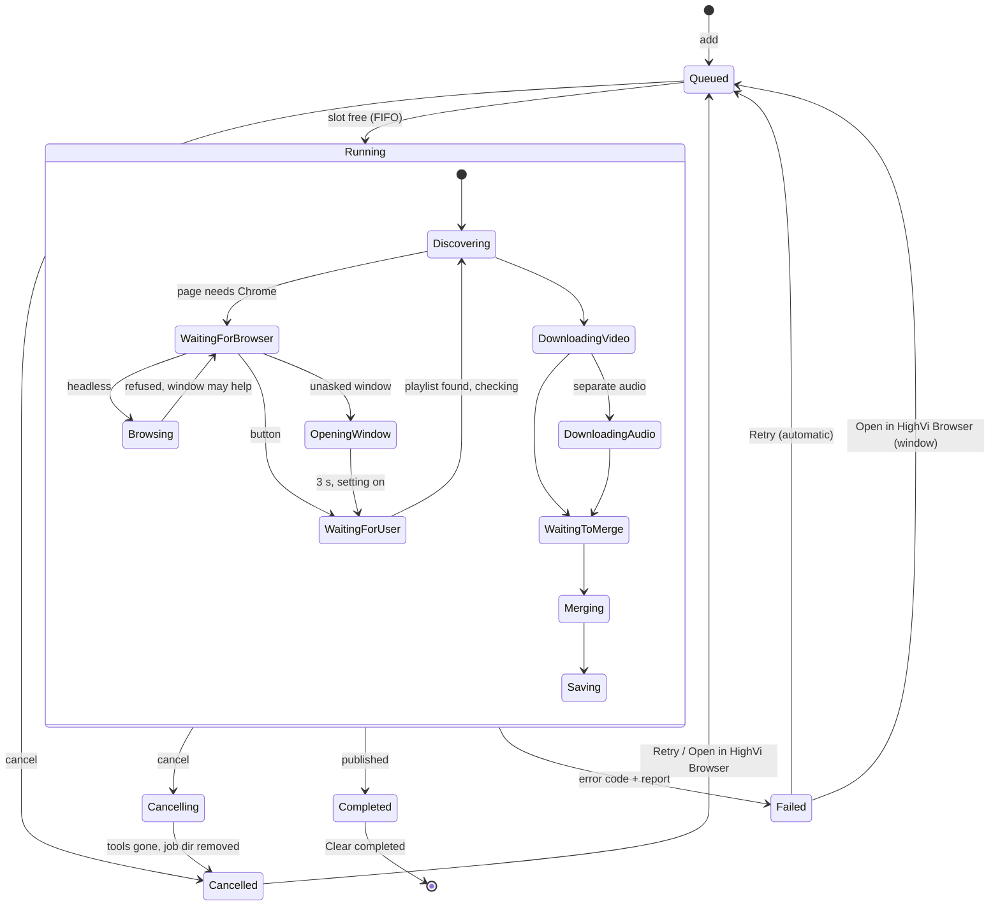
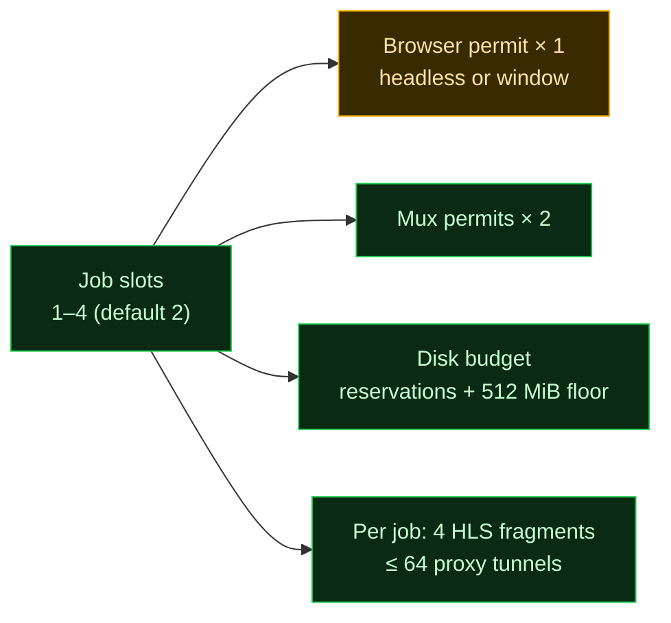

# HighVi architecture

For contributors. It covers how the pieces fit, why they are shaped this way, and the limits
that hold them in place. Security details live in [SECURITY.md](../SECURITY.md); the day-to-day
development loop lives in [WORKFLOW.md](WORKFLOW.md). Diagrams are [Mermaid](https://mermaid.js.org/)
and render on GitHub.

## 1. Design tenets

1. **The webview is untrusted.** It sends sources and item IDs, and it gets back snapshots and
   progress. It never sees a media URL, and nothing it sends is used without validation in Rust.
2. **One network route.** Every request that yt-dlp or Chrome makes goes through a per-job
   `CONNECT` proxy that only lets public HTTPS through. FFmpeg never touches the network.
3. **A human stays in the loop.** HighVi does not decrypt DRM, does not use the user's browser
   sessions, and does not get past bot checks. When a site refuses the hidden browser, a
   *visible* window opens and the user acts in it. HighVi never clicks for them.
4. **Every resource is bounded and every wait can be cancelled.** This covers time, bytes,
   processes, disk, browsers and muxes. Cancel and exit kill whole process groups and remove
   the job directory.
5. **Failures say where they happened.** Each failure gets a code tied to the stage that failed
   (page, browser-found playlist, media), plus a URL-free diagnostic report.

## 2. System context



| Path | Responsibility |
| --- | --- |
| `ui/` | Static webview UI (no framework). It sends sources and item IDs, and renders queue snapshots (applied only when newer) and progress. It keeps the user's **auto-window** choice in `localStorage` and pushes it to Rust on load. It never sees media URLs. |
| `src-tauri/src/lib.rs` | Tauri commands: `queue_*` (add, start/pause, concurrency, cancel, retry, open in browser, remove, snapshot, diagnostics), `set_auto_window`, `dependency_status`, `open_output_folder`. Emits `queue-changed` and `queue-progress`. On exit and on SIGTERM/SIGHUP/SIGINT it cancels everything and waits up to 5 s. |
| `crates/highvi-core/src/queue.rs` | The scheduler: FIFO, 1–4 jobs at once, one lock for all state, revisioned snapshots, progress only for the current attempt. Pauses itself when a tool is missing or too old. |
| `crates/highvi-core/src/job.rs` | The job: discover → choose formats → download tracks → mux → publish. It also owns the decision to open a window unasked (`window_opens_unasked`) and the notice before it. |
| `egress.rs`, `netpolicy.rs` | Per-job `CONNECT` proxy on 127.0.0.1, the only network route for yt-dlp and Chrome. It resolves names itself, refuses a name if any of its addresses is private, and accepts HTTPS only. |
| `ytdlp.rs`, `formats.rs` | Hermetic yt-dlp arguments (`--ignore-config`, no plugins, no cookies, no JS runtimes, 4 concurrent fragments). Parses and sanitises its JSON and chooses formats. |
| `browser.rs`, `hls.rs` | Chrome over a DevTools pipe, headless or as a visible HighVi window (`Mode`). Ranks the playlists it observes. |
| `mux.rs` | Magic-byte sniffing and the locked-down FFmpeg mux. |
| `process.rs` | Child processes: no shell, cleared env, own process group, bounded output. Cancel or timeout kills the whole group. |
| `filesystem.rs` | `Downloads/HighVi`, private locked job directories, no-replace publishing. |
| `classify.rs` | Maps yt-dlp output to an error code, attributed to what was being fetched. |
| `tools.rs` | Tool versions. Reports when yt-dlp is too old to run (`MINIMUM_YT_DLP`), older than a site needs (`SITE_MINIMUMS`), or older than tested. |
| `diagnostics.rs` | Per-job report for a failed job: stages, codes, versions, host names only. |
| `e2e.rs` (tests only) | Local HTTPS fixture and synthetic media; real yt-dlp, FFmpeg and Chrome. |

## 3. Trust boundaries



Anything that reaches the core is either validated or produced by a bounded parser. Media URLs
stay in the job directory, which is private (0700) and locked, and they never return to the
webview.

## 4. Job pipeline



Notes:

- Stage B (scanning static HTML) is yt-dlp's generic extractor; HighVi does not duplicate it.
- There is no separate discovery ticket. The job owns its discovery result end to end, so no
  media URL crosses into the UI and nothing can be substituted.
- **Open in HighVi Browser** (the button) skips straight to the window with no notice and a
  10-minute budget, because the user just asked for it.

## 5. Discovery with the HighVi browser window

The sequence below is the case that motivated the window: a site that refuses headless Chrome
but shows a normal browser the page.



## 6. Queue item lifecycle



Each launch carries `(id, attempt)`. Anything that arrives from an older attempt (progress,
results) is ignored, and every launch frees its slot exactly once, even if the job panics.

## 7. Concurrency and shared resources



- A job holds at most one shared permit at a time, so waiting for one cannot deadlock.
- One browser at a time keeps memory bounded, and it also means unasked windows open one after
  another, never stacked. The 3-minute budget for an unasked window caps how long it can hold
  the browser in an unattended queue.
- The `auto_window` flag is read **when the window is about to open**, so switching it off
  stops a window that is still being announced, even in jobs already running.

## 8. Download throughput

Servers usually cap the speed of each connection, and yt-dlp's default fetches one HLS fragment
at a time. Measured on 2026-10-19 on a public test stream (Mux `x36xhzz`, 480p, 68 MiB, runs one
after another on the same link):

| Run | Time | Speed |
| --- | --- | --- |
| HighVi's arguments, through the egress proxy | 65.5 s | 1.04 MiB/s |
| Same arguments, no proxy | 62.7 s | 1.09 MiB/s |
| Through the proxy, `--concurrent-fragments 4` | **20.0 s** | **3.42 MiB/s** |

The proxy costs about 4% (within noise). The bottleneck was fetching fragments one at a time.
`ytdlp::CONCURRENT_FRAGMENTS` is 4: large enough to fill a typical link, and small enough that
4 jobs × 4 fragments stays polite to rate-limited sites and well under the proxy's 64 tunnels.

## 9. Failure attribution

| Where it failed | Code |
| --- | --- |
| Page refused (yt-dlp or browser: 401/403/451) | `access_denied` (`host_firewall_block` for Cloudflare / `cf-mitigated: challenge`) |
| Page or playlist rate-limited (429) | `rate_limited` |
| Browser: page never arrived / HTTP error | `media_discovery_timeout` / `page_unavailable` |
| Browser: the player's playlist was refused (4xx) | `playlist_access_denied` (also when yt-dlp is refused a browser-found playlist) |
| Browser: page loaded, no playlist | `no_media_found` |
| Window closed / out of time | `browser_closed` / `interactive_timeout` |
| Unasked window could not run, or was switched off during the notice | the **original** refusal (internally `window_not_opened`, `browser_failed`) |
| Media file or segments refused after metadata succeeded | `media_access_denied` |

`browser_can_help` lists the codes where the row offers **Open in HighVi Browser**.
`window_opens_unasked` is that list minus `page_unavailable` and the window's own endings.
Extractor-related failures carry a `hint` to update yt-dlp when it is older than the site needs
(YouTube: 2026.08.19), older than `RECOMMENDED_YT_DLP`, or more than 90 days old.

## 10. Bounds

| What | Limit |
| --- | --- |
| yt-dlp metadata | 8 MiB stdout, 60 s |
| yt-dlp download | native HLS, 4 concurrent fragments, retries: 3 requests, 5 fragments, 1 extractor; 20 s socket timeout |
| Browser (both modes) | `<profile>/bin` first on Chrome's `PATH`: no-op `xdg-open`, `xdg-email`, `xdg-mime`, `xdg-settings`, `gio`… so links meant for desktop apps go nowhere; native file chooser intercepted (CDP); downloads denied |
| Browser discovery | 30 s per page; gives up ~8 s after trying to play; ≤ 48 sessions, ≤ 4 000 tracked requests, ≤ 60 body reads |
| HighVi browser window | unasked: 3 s notice (`JobLimits::window_notice`), then ≤ 3 min (`auto_window_budget`); button: ≤ 10 min (`interactive_budget`). New playlists are checked *while the window stays open*; only one that passes ends it. Ends otherwise on a closed window (`browser_closed`, only on a clean Chrome exit; a crash is `browser_failed`), on cancel, or at the limit (`interactive_timeout`). Never presses play or makes a user gesture. Popups and new tabs are attached and watched. Same flags, proxy, sandbox and limits as headless; the environment adds only the display (absolute Wayland socket, or `DISPLAY` + `XAUTHORITY`), a private `XDG_RUNTIME_DIR` and `DBUS_SESSION_BUS_ADDRESS=disabled:` |
| Proxy | ≤ 64 tunnels, 8 KiB request head, 10 s head/resolve, 15 s connect, 90 s idle |
| yt-dlp `PATH` | `<job>/bin` with only a link to the real `python3`: no helpers (phantomjs, FFmpeg); JS runtimes off via `--no-js-runtimes` |
| Diagnostic report | 4 KiB, in memory, failed jobs only |
| Track download | 24 h each; stopped as `download_stalled` below 64 KiB of progress in any 2 min |
| Disk | before downloading: free − other jobs' reservations ≥ 2 × estimated size + 512 MiB floor; while downloading and muxing (checked every second): stop below the floor (`insufficient_disk_space`) |
| DevTools messages | events ≤ 1 MiB, replies ≤ 16 MiB; queued messages ≤ 64 MiB weighted, backlog ≤ 16 MiB; tracked URLs ≤ 8 MiB; overflow → `discovery_overloaded` |
| Mux | 30 min |
| Jobs | 1–4 at once (default 2); queue ≤ 200 items, ≤ 100 per add; one Chrome and two muxes at a time; Chrome never runs while idle |

## 11. UX: rows that need the user

A row that needs the user has to stand out without being mistaken for an error, and it has to
work for everyone.

| Decision | Why |
| --- | --- |
| Amber `#ffb000` (`--attention`) | The other classic CRT phosphor, so it fits the green theme. Amber conventionally means "needs attention", not "failed" (red `--danger`) or "fine" (green). Contrast is 11.3:1 on the background (WCAG AAA). |
| Never colour alone | Green and amber look alike with red-green colour blindness, so the row also gets a ▶ marker, bold status text, a 4 px left border and the words "This page needs you to press play". |
| Gentle motion, stronger just before the window | While a row needs the user it breathes: a soft amber glow every 2.4 s, so the eye finds it among other rows. During the 3 s notice the glow is quicker and stronger (0.8 Hz). Both stay far below the 3 flashes/s limit of WCAG 2.3.1, change only a glow, never flash the whole row, and stop with `prefers-reduced-motion`. |
| Say it before it happens | The 3 s notice and an `aria-live="assertive"` announcement come before the window takes focus, so it is never a surprise. The text explains why and that the window closes by itself. |
| The user decides | **Open the HighVi browser by itself** is on by default. It is kept per computer and takes effect immediately, including during a notice. Turned off, the row shows the refusal and the button, as before. |

## 12. Decision log

| Decision | Alternatives considered | Reason |
| --- | --- | --- |
| Visible window where the user acts; no hidden "stealth" browser | A headed browser hidden off-screen, or user-agent spoofing to pass bot checks | That would defeat a site's access control without the user. It conflicts with tenet 3 and adds legal risk (see README, Disclaimer). |
| Open the window in the same attempt | Requeue as a new interactive attempt | No queue churn, the same job directory and diagnostics, and one progress row. |
| 3 s notice, after the browser permit | Notice before waiting for the browser | A notice is only useful right before the window appears, however long the wait for the browser was. |
| 3 min for an unasked window, 10 for the button | One budget for both | An unattended bulk queue must not hold the one browser for long, while someone who asked has time. |
| Fall back to the original refusal | Show the window's technical failure | The refusal explains more and keeps the button. |
| 4 concurrent fragments | 1 (yt-dlp default) or 8+ | Measured 3.3× faster; bounded politeness (§8). Accepted cost: when one fragment fails for good, the other workers keep fetching ahead during its retries (more requests and `.part-Frag*` files before the job fails). That is bounded by the retry time, covered by the 2× disk reservation, and removed with the job directory. |
| Notice only for a window that will open | Announce first, check later | The setting is checked before the notice and again after it, so the row never promises a window that will not come. |

## 13. Tests

```bash
HIGHVI_REQUIRE_E2E=1 cargo test --workspace   # unit + end-to-end (needs yt-dlp, ffmpeg, ffprobe, Chrome)
Xvfb :99 & HIGHVI_TEST_DISPLAY=:99 HIGHVI_REQUIRE_HEADED=1 HIGHVI_REQUIRE_E2E=1 cargo test --workspace
                                               # also the visible-window tests, on that Xvfb only
node scripts/check-ui.mjs                      # EN/VI/JA catalogue parity, every Rust error code translated, README code tables real and in sync
```

Without `HIGHVI_REQUIRE_E2E`, end-to-end tests skip when a tool is missing. CI sets it, pins
yt-dlp, and runs Chrome with its sandbox on. The visible-window tests cover:

- the incident (refused headless, downloaded in the window);
- the unasked window: notice, then window, then download; no window for a 404 or a bare playlist;
- the notice stopped by the setting or by cancel;
- an unasked window timing out on its own budget.
