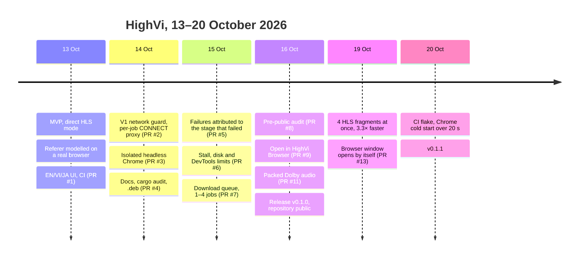
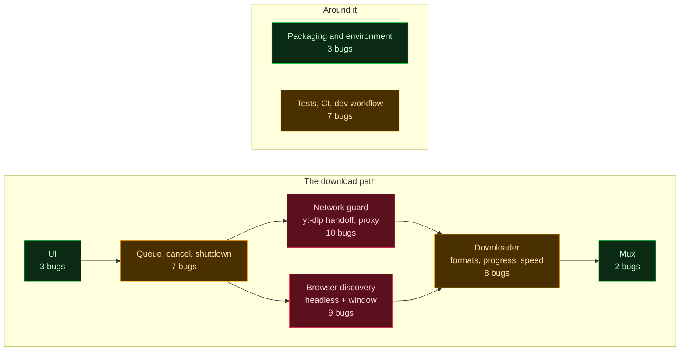
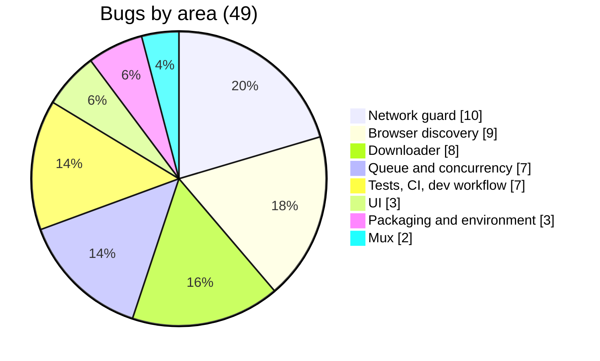
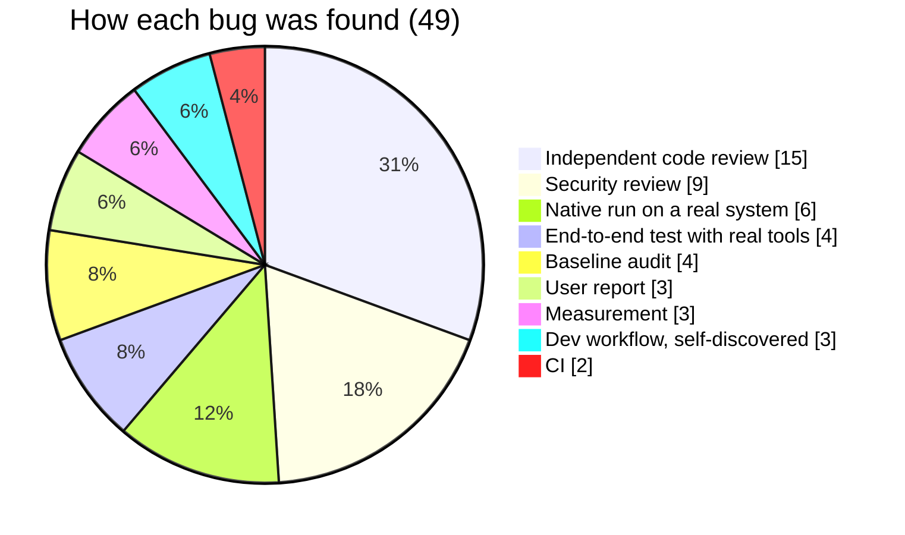
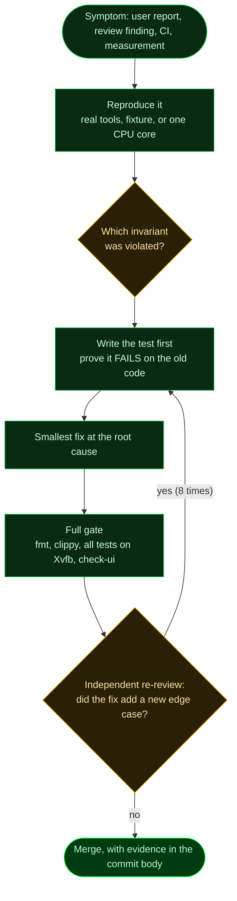
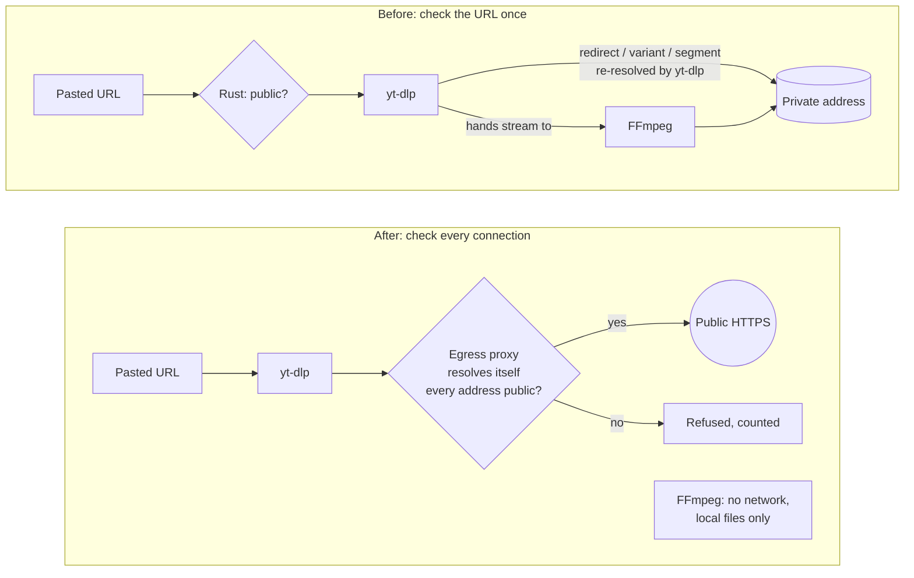
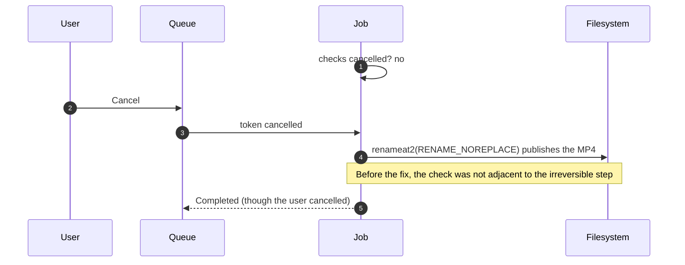
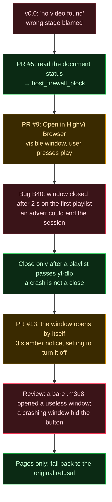
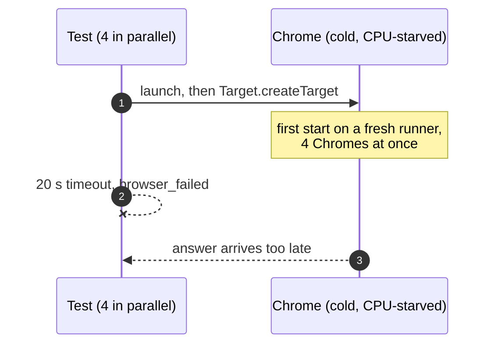
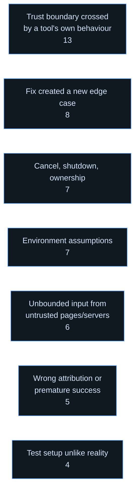

# The HighVi journey: bugs, fixes and lessons

This is an honest record of how HighVi was built between 13 and 20 October 2026. It covers what
broke, where in the code it broke, how each bug was found and fixed, and what we would do
differently.

It is written for contributors, and for anyone building a tool that drives other tools
(yt-dlp, a browser, FFmpeg) on behalf of a user. The architecture itself is described in
[ARCHITECTURE.md](ARCHITECTURE.md), and the development loop in [WORKFLOW.md](WORKFLOW.md).

## 1. At a glance

| | |
| --- | --- |
| Duration | 8 days, from MVP (13 Oct) to v0.1.1 (20 Oct) |
| Pull requests | 13 merged, plus the v0.1.1 release branch |
| Commits | ~70 |
| Bugs catalogued | **49**, each with its root cause, location and fix (§7) |
| Bugs found by the author's own tests | 4 of 49. Independent review found 24, native runs and measurements 9, users and CI 5, the baseline audit 4, the dev workflow 3 (§3). |
| Tests at the end | 188 unit and end-to-end tests with real yt-dlp, FFmpeg and Chrome, on two yt-dlp versions in CI |

## 2. Timeline

## 3. Where the bugs lived

### By component (heat map)

The darker the box, the more bugs it produced. Most bugs sit where HighVi **hands work to
another program**. HighVi's own logic produced comparatively few.

### By how they were caught

The headline: **independent, read-only review found half of all bugs**, including both High
severity security issues (B16, B20). The author's tests passed while those bugs were present.

## 4. How a bug travelled through the process

The re-review loop was not decoration. Eight fixes needed a second or third round (B18, B30,
B31, B33, B42, B44, B45 and the auto-window fallback), because **every fix is a new mechanism
with its own failure modes**.

## 5. Case studies

### 5.1 Validating the URL was not enough (B5, B6, B7)

**Symptom.** A baseline audit showed that a public page could still make HighVi reach private
addresses: through DNS rebinding, redirects, variant playlists, segments and keys. yt-dlp could
also hand streams to FFmpeg, which then fetched them on its own.

**Root cause.** HighVi checked the URL once, in Rust. But yt-dlp resolves names again and
follows links by itself, so the check happened in the wrong place.

**Fix.** A per-job `CONNECT` proxy became the only network route for yt-dlp and Chrome
(`egress.rs`, 53f6cb3). It uses an allowlist of address classes, refuses a name if any one of
its addresses is private, and blocks plain HTTP. FFmpeg's network access was **removed**, not
policed.

**Lessons.** Enforce policy where the connection is made, not where the URL is read. Remove a
capability rather than try to police it.

### 5.2 A flag that silently did nothing (B20)

**Symptom.** A security review reproduced WebRTC STUN packets reaching the LAN and the
internet over UDP, bypassing the proxy (5 packets).

**Root cause.** The Chrome flag `--force-webrtc-ip-handling-policy` does not exist in that
Chrome version. Chrome ignored it silently, so the "protection" was never there.

**Fix.** Use the policy that does exist, set in the profile preferences. Add an end-to-end test
that counts UDP packets; it fails before the fix (7c79019).

**Lesson.** A control whose effect you have not observed is not a control. For every
security-relevant flag, write a test that would fail if the flag were ignored.

### 5.3 Cancel lost a race with "save" (B14, B15)

**Symptom.** A cancel that arrived during saving, or between the "Saving" check and the
rename, still published the file.

**Fix.** Check the token immediately before every `renameat2`. Mark running job directories
with an `flock` so a second HighVi cannot clean a live job (afc73bf, 2d7416f).

**Lesson.** Check the user's intent right before the irreversible step, and make ownership an
OS-level lock rather than a convention.

### 5.4 "No video found" that was really "you are not welcome here" (B26, B39, B40, auto window)

**Symptom.** A user reported that a page played in their own Chrome, but HighVi said "no video
found".

**Investigation.** Two page loads were enough to measure it. Headless Chrome got
`403 cf-mitigated: challenge`. A **visible** Chrome with the same flags, the same fresh profile
and the same IP got `200`. The site refuses headless browsers.

**What we deliberately did not build.** A hidden or "stealth" browser that passes bot checks
without the user. That would defeat a site's access control. HighVi's answer is a visible window
in which **the user** acts, and HighVi never clicks for them (B41 removed even the synthetic
"play" gesture, because a page could borrow it).

**Lessons.** Attribute every failure to the stage that failed. Measure the cause before building
a fix. Declare success only after validation.

### 5.5 "The app is slower than the terminal" (B46)

**Symptom.** The owner saw downloads in HighVi run slower than `yt-dlp` in a terminal.

**Investigation.** The tempting suspect was HighVi's security proxy. Measuring settled it: four
runs one after another, on the same public test stream and the same link.

| Run | Time | Speed |
| --- | --- | --- |
| `yt-dlp` defaults in a terminal | 76 s | 0.83 MiB/s |
| HighVi's arguments, through the proxy | 65 s | 1.04 MiB/s |
| HighVi's arguments, no proxy | 63 s | 1.09 MiB/s |
| Through the proxy, 4 fragments at once | **20 s** | **3.42 MiB/s** |

The proxy cost about 4%. The real bottleneck was that servers cap each connection while yt-dlp
fetched **one fragment at a time**. HighVi was also running 4 videos at once, which split the
bandwidth.

**Fix.** `--concurrent-fragments 4` (55dad57), with a test that fails without it. The accepted
cost: when one fragment fails for good, the other workers fetch ahead until its retries run out.

**Lesson.** Measure before you blame the security layer. "Obvious" suspects are often innocent.

### 5.6 Green on the PR, red on main (B34)

**Symptom.** After PR #13 merged, CI on `main` failed in one of the two matrix jobs. Four
browser tests returned `browser_failed`. The **identical tree** had passed CI 30 minutes earlier.

**Investigation.** All four failures landed about 20 s after the tests started. That matches
`STARTUP_TIMEOUT` (20 s) for Chrome's first DevTools call, `Target.createTarget`. Reproduced
locally by pinning the tests to **one CPU core**: the same `browser_failed`, from a cold,
contended Chrome start.

**Fix.** Allow 60 s for the first answer. A Chrome that never answers is still reported. The
regression test wraps Chrome in a script that holds it back for 25 s. It fails on the old 20 s
and passes now, and the one-core reproduction passes too (v0.1.1).

**Lesson.** A fixed timeout is a bet about the machine. CI runners and users' first launches
are slow. Test under load (one core), and do not mistake "slow" for "crashed".

## 6. Recurring patterns

1. **Trust boundary crossed by a tool's own behaviour** (B2, B4, B5, B6, B16, B17, B19, B20,
   B28, B36 and others). yt-dlp, Chrome and FFmpeg each have fallbacks, control headers and
   mini-languages of their own. They are where HighVi's guarantees leaked.
2. **A fix created a new edge case** (B18, B30, B31, B33, B42, B44, B45).
3. **Cancel, shutdown and ownership** (B11, B14, B15, B32, B37, B38).
4. **Environment assumptions** (B10, B29, B33, B35, B43, B47, B48): missing XDG folders, an
   old APT yt-dlp, the Chromium snap, pipx shebangs, a shared build folder.
5. **Unbounded input** (B8, B21, B30, B42, B44): every buffer an untrusted page can fill needs a
   byte budget.
6. **Wrong attribution or premature success** (B1, B26, B27, B33, B40).
7. **Test setup unlike reality** (B23, B24, B29, B34): a fixture without CORS, base64 bodies
   from Chrome, one install layout, a fast developer machine.

## 7. Full bug catalogue

Caught by: **IR** = independent code review, **SR** = security review, **E2E** = end-to-end
test with real tools, **NR** = native run, **M** = measurement, **U** = user report.

| ID | Area | Symptom | Root cause | Where | Fix | Caught by |
| --- | --- | --- | --- | --- | --- | --- |
| B1 | Downloader | CDN 403 on a pasted playlist | No Referer where a browser sends one | argv | d2251e6 | U |
| B2 | Network guard | Full page URL leaked to other hosts | `--add-headers` applies to every request | Referer builder | b0e8866 | IR |
| B3 | UI | Signed token shown via the file name | Redaction kept the last path segment | `redact_url_for_display` | b0e8866 | IR |
| B4 | Network guard | Page URL replayed via `--load-info-json` | Data fed back to a tool keeps the tool's state | info-JSON handoff | 53f6cb3 | E2E |
| B5 | Network guard | Private addresses reachable past the first hop | URL checked once; yt-dlp re-resolved | new egress proxy | 53f6cb3 | Audit |
| B6 | Network guard | FFmpeg fetched on its own | Tool delegation escaped the proxy | yt-dlp args, mux | 53f6cb3 | Audit |
| B7 | Network guard | NAT64, 6to4 and Teredo not blocked | Deny-list missed ranges | address policy | 53f6cb3 | Audit |
| B8 | Downloader | "Successful" MP4 with gaps | yt-dlp skips missing fragments by default | download args | 53f6cb3 | Audit |
| B9 | Queue | Async stack overflow | 8 KiB buffers on async stacks | job code | 53f6cb3 | NR |
| B10 | Environment | Fails without an XDG Downloads folder | Assumed the folder exists | output folder | 53f6cb3 | NR |
| B11 | Queue | SIGTERM left the job directory | Signals not routed to exit | signal handling | 53f6cb3 | NR |
| B12 | UI | Status text off-screen | Layout assumption | UI | 53f6cb3 | NR |
| B13 | Downloader | CJK and emoji titles over 255 bytes | Limit counted in characters, not bytes | name sanitiser | afc73bf | IR |
| B14 | Queue | Cancelled job still published | Check not adjacent to the rename | publish step | afc73bf, 2d7416f | IR |
| B15 | Queue | Second process cleaned a live job | No OS-level ownership | stale cleanup | afc73bf | IR |
| B16 | Network guard | Format `all` or `b` picked rejected formats | External string in yt-dlp's selector language | format selection | d37ed29 | SR |
| B17 | Network guard | Page header replaced `--proxy` | Tool control namespace forwarded | header filter | d37ed29 | SR |
| B18 | Network guard | Duplicate format IDs; IPv4-mapped own address | Identity and canonical form | format pick | b2c92a6 | SR |
| B19 | Downloader | After a failure yt-dlp re-extracted directly | Hidden fallback inside the tool | info-JSON fields | 3a467cc | IR |
| B20 | Browser | WebRTC UDP around the proxy | Non-existent Chrome flag silently ignored | launch flags | 7c79019 | SR |
| B21 | Browser | Page could make HighVi hold GBs of URLs | Unbounded DevTools data | DevTools reader | 7c79019, 48453fc, 034b0b6 | SR |
| B22 | Browser | Clear variant of a DRM master offered | Skipped before variants were recorded | ranking | 3957282 | IR |
| B23 | Tests | Fixture page fetch failed | Fixture lacked CORS, unlike real CDNs | fixture | PR #3 | E2E |
| B24 | Browser | HLS bodies unreadable | Chrome returns them base64-encoded | CDP body reader | PR #3 | E2E |
| B25 | UI | Idle window used 52% of a core | Endless canvas animation | UI | 1ff0c28 | M |
| B26 | Browser | Bot check reported as "no video" | Document status ignored | discovery result | d2af6d4 | U |
| B27 | Downloader | YouTube 403 on media | Old yt-dlp client refused upstream | classification | d2af6d4 | U, NR |
| B28 | Network guard | yt-dlp helpers could bypass the proxy | Ambient PATH and interpreter directory | tool environment | d2af6d4, 2a1754a | SR |
| B29 | Tests | Helper test failed on CI | Assumed one install layout | test helper | 880a2be | CI |
| B30 | Downloader | Trickling server held a job; stderr moved the meter | No progress floor; untrusted text as progress | stall meter | 48453fc, 034b0b6 | IR |
| B31 | Downloader | Redirect after the cap lost; audio reserved no disk | Limit order; missing estimate field | tracker, estimate | 7743225, 6012ac2 | IR |
| B32 | Queue | Panicking runner leaked a slot | Slot release not tied to task lifetime | queue.rs | 76616d9 | IR |
| B33 | Environment | Old APT yt-dlp failed every job; one site's text paused the queue | Old tool; untrusted text set global state | version probe | f69e8f5, 48e173f | NR, IR |
| B34 | Tests | `browser_failed` after merge | 20 s Chrome startup timeout on a cold runner | browser.rs | v0.1.1 | CI |
| B35 | Tests | Browser counter wrong on the Chromium snap | Command line cut at 120 characters | e2e counter | 77f659d | E2E |
| B36 | Environment | Signed URL in `/proc/<pid>/cmdline`; source tags copied | Secrets in argv; metadata passthrough | argv, mux | 2cf8a9a | SR |
| B37 | Queue | Cleanup followed a symlink; tools outlived HighVi | No symlink check; children not tied to the parent | cleanup, spawn | 4681d3c | IR |
| B38 | Network guard | Check-then-use window on the symlink check | Race in the same trust domain | cleanup | 76b845a (accepted) | IR |
| B39 | Browser | Cloudflare-protected video site refused headless Chrome | Site refuses headless browsers | discovery | 6f796fe | M |
| B40 | Browser | Window closed on an advert; crash read as a close | Success before validation | interactive attempt | 3ef922f | IR |
| B41 | Browser | Page could borrow HighVi's synthetic gesture | HighVi lent the page a privilege | play script | 3ef922f, f023379 | SR |
| B42 | Browser | Memory growth; adverts hid the video; Ctrl+T tab missed | Unbounded stores; rank before filter | window checks | f023379, 19dd499 | SR |
| B43 | Mux | Apple's HLS example: `unsupported_container` | Only packed AAC handled | `mux::sniff` | a2bd56f | NR |
| B44 | Mux | Dolby rewrite filled disk; malformed header panicked | Unbounded write; unvalidated slicing | `unpack_dolby` | 151e92e, b358989 | IR |
| B45 | Queue | Check round overran into `browser_failed` | Nested deadlines did not add up | `CHECKS_ALLOWANCE` | a2bd56f | IR |
| B46 | Downloader | Download 3× slower than possible | One fragment at a time | download args | 55dad57 | M |
| B47 | Tests | Shared build folder built the wrong checkout | Shared mutable build state | dev workflow | (practice) | self |
| B48 | Tests | GUI test touched the owner's live clipboard | Shell inherited the live desktop session | test harness | `HIGHVI_TEST_DISPLAY` (6f796fe) | self |
| B49 | Tests | `pkill -f` matched its own shell | Pattern matched the caller's command line | dev workflow | (practice: PIDs) | self |

## 8. Lessons

| # | Lesson | Bugs |
| --- | --- | --- |
| 1 | Enforce policy at the connection, not at the URL. | B5, B6, B20 |
| 2 | Remove capabilities instead of policing them. | B6, B28 |
| 3 | Never pass external strings into a tool's mini-language or control namespace. | B16, B17, B19 |
| 4 | Check intent right before the irreversible step. | B14, B40 |
| 5 | A control whose effect you have not observed is not a control. | B20, B41 |
| 6 | Bound everything an untrusted page or server can feed, in bytes and in time. | B8, B21, B30, B42 |
| 7 | Attribute a failure to the stage that failed, and say so in the error. | B1, B26, B27, B33 |
| 8 | Measure the cause before building the fix. | B25, B39, B46 |
| 9 | Re-review every fix; it is a new mechanism. | B18, B31, B42, B44 |
| 10 | Fixtures, CI and test machines must resemble reality, including slow ones. | B23, B24, B29, B34, B35 |
| 11 | Children die with the parent; cleanup never follows links. | B11, B37 |
| 12 | A fixed timeout is a bet about the machine; give nested deadlines margins. | B34, B45 |
| 13 | One site's text must never decide global state. | B33 |
| 14 | Isolate the build and the test environment from the developer's own session. | B47, B48, B49 |
| 15 | Write down accepted risks with their reasons. | B38 |

## 9. Practices that worked

- **Failing test first.** Commit bodies record "fails on the old code" for B2, B14, B15, B20,
  B31, B32, B33, B42, B44, B46 and B34.
- **Mutation checks.** Temporarily break the guarded behaviour and watch the test fail. Examples:
  the auto-window fallback, the page-only guard, `--concurrent-fragments`, a "secretly headless"
  window.
- **One network chokepoint.** The egress proxy stopped redirects, rebinding and header tricks,
  for about 4% of throughput.
- **Independent, read-only review.** It found half of all bugs and both High security issues.
- **Real tools in end-to-end tests.** Real yt-dlp, FFmpeg, Chrome and the Chromium snap exposed
  B24, B33, B35 and B43, which mocks would have hidden.
- **Private displays.** Visible-window tests and screenshots run only on Xvfb, never on the
  desktop in use.
- **Numbers over impressions.** Idle CPU went from 52% to 0, a download from 65 s to 20 s, and
  peak memory from 203 to 88 MB.

## 10. Checklist for the next feature

- [ ] Which program does the work (HighVi, yt-dlp, Chrome, FFmpeg)? What can that program do
      that HighVi did not ask for?
- [ ] Does every new network path go through the egress proxy?
- [ ] Is every buffer fed by a page or server bounded in bytes and time?
- [ ] Is cancel checked right before each irreversible step? Do child processes die with
      HighVi?
- [ ] Does each failure name the stage that failed, and leave the user a way forward?
- [ ] Is there a test that fails on the old code, and has the fix been mutation-checked?
- [ ] Has it been tested on a slow machine (one core) and on both supported Ubuntu versions?
- [ ] Has someone other than the author reviewed it read-only, and then re-reviewed the fixes?
- [ ] Is the claim backed by a measurement, not an impression?
