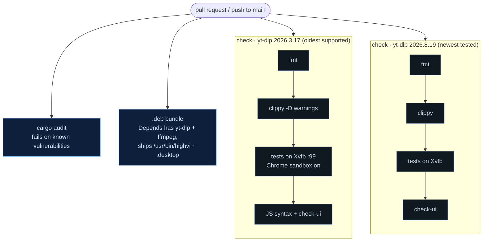

# HighVi engineering workflow

How a change goes from an idea to a release. The architecture behind it is in
[ARCHITECTURE.md](ARCHITECTURE.md).

## 1. The path of a change

```mermaid
flowchart LR
  classDef local fill:#0b2a14,stroke:#19c94b,color:#c8ffd4
  classDef ci fill:#0d1f3a,stroke:#5aa0ff,color:#d6e6ff
  classDef human fill:#3a2a00,stroke:#ffb000,color:#ffe2a8

  A["Branch from main<br/>feature/… or fix/…"]:::local --> B["Reproduce / measure<br/>write the failing test first"]:::local
  B --> C["Implement the smallest change"]:::local
  C --> D["Local gates<br/>fmt · clippy · tests on Xvfb · check-ui"]:::local
  D --> E["Independent review<br/>read-only, findings fixed + tested"]:::local
  E --> F["Push, open PR"]:::ci
  F --> G["CI on the exact head SHA<br/>check × 2 yt-dlp · audit · .deb"]:::ci
  G -->|red| C
  G -->|green| H["Owner merges"]:::human
  H --> I["Release: tag, packages,<br/>SHA256SUMS (owner approves)"]:::human
```



Merging, tagging, releasing and making the repository public are always the owner's decision.
Automation and agents prepare the work and stop at that point.

## 2. Local loop

```bash
cargo fmt --all -- --check
cargo clippy --workspace --all-targets --locked -- -D warnings
node --check ui/app.js && node --check ui/i18n.js && node --check ui/rain.js
node scripts/check-ui.mjs        # EN/VI/JA parity, every Rust error code translated, README tables in sync

# Full suite, including the visible-window tests, on a private display:
Xvfb :99 -screen 0 1600x1000x24 -nolisten tcp &
env -u WAYLAND_DISPLAY GDK_BACKEND=x11 \
  HIGHVI_REQUIRE_E2E=1 HIGHVI_REQUIRE_HEADED=1 HIGHVI_TEST_DISPLAY=:99 \
  cargo test --workspace --locked
```

Rules that keep tests honest:

- **Fail first.** A regression test must fail on the old code. Prove it by temporarily
  reverting the fix, then restore. Recent examples:
  - disabling the auto-window fallback makes `a_refused_page_opens_the_highvi_browser_by_itself`
    fail with `host_firewall_block`;
  - dropping the page-only guard makes a bare `.m3u8` open a window;
  - removing `--concurrent-fragments` fails `fragments_are_fetched_in_parallel`.
- **Never the real desktop.** Tests open windows only on the display named by
  `HIGHVI_TEST_DISPLAY`. When you drive the app by hand on Xvfb, unset `WAYLAND_DISPLAY`, set
  `GDK_BACKEND=x11`, use a throwaway `HOME`, and stop processes by PID. Never use
  `pkill highvi`, which would also hit an installed HighVi.
- **Measure before you optimise.** Speed claims need numbers taken one after another on the same
  link (see ARCHITECTURE.md §8). A temporary harness is fine, but remove it before committing.
- **Public, safe fixtures only.** Tests and screenshots use the local fixture, `example.com` and
  Mux's public test streams. Never put a real site's media in the repository.

## 3. Continuous integration



- yt-dlp is pinned per matrix entry, so a new yt-dlp release cannot silently change results.
- Actions are pinned by commit SHA, and the checkout does not persist credentials.
- "Green" means green **on the PR's head SHA**. A later push needs a new run.

## 4. Review

Every change that touches user state, the network, the browser or the queue gets an
independent, read-only review before the PR. It asks:

- **Stale async completion and newer user intent:** can a result or setting change from earlier
  win over a newer one? (E.g. the auto-window setting is re-read after the notice.)
- **Cancellation:** does cancel work in every wait, and does it clean up processes and job
  directories?
- **Misleading UI status:** does the row say what is really happening, and does the user keep a
  way forward (the button, Retry)?
- **Security boundaries:** does any new path bypass the egress proxy, validation or the "no
  gestures" rule?
- **Cardinality:** what happens with 4 jobs × N links (windows one after another, 4 fragments
  per job, ≤ 64 proxy tunnels)?

Each finding is fixed together with a test that covers it, or written down as an accepted trade-off.

## 5. Packaging and installing a build

```bash
npm ci --ignore-scripts
npx tauri build --bundles deb          # target/release/bundle/deb/HighVi_<version>_amd64.deb
sudo apt install --reinstall ./HighVi_<version>_amd64.deb   # --reinstall when the version is unchanged
```

`cargo clean` removes `target/` (several GB after a release build). Copy the `.deb` out first.

## 6. Documentation and screenshots

- README in three languages (EN/VI/JA) with the same sections. `check-ui` keeps the
  troubleshooting tables in sync with the real error codes.
- Screenshots come from the **release app on Xvfb** with a throwaway `HOME`, driven with XTEST
  input and captured with `ffmpeg -f x11grab`. The content must be public and safe
  (`example.com`, Mux test streams). Shrink them to 256-colour PNGs before committing.
- Diagrams are Mermaid in Markdown, so they stay reviewable as text.

## 7. Release (owner only)

1. Bump the version in `Cargo.toml` (workspace), `src-tauri/tauri.conf.json` and `package.json`.
2. CI is green on the release commit.
3. Build `.deb` + AppImage, install and run them in clean Ubuntu 24.04 and 26.04 containers, and
   write `SHA256SUMS`.
4. The owner tags, publishes the GitHub release and attaches the files.
